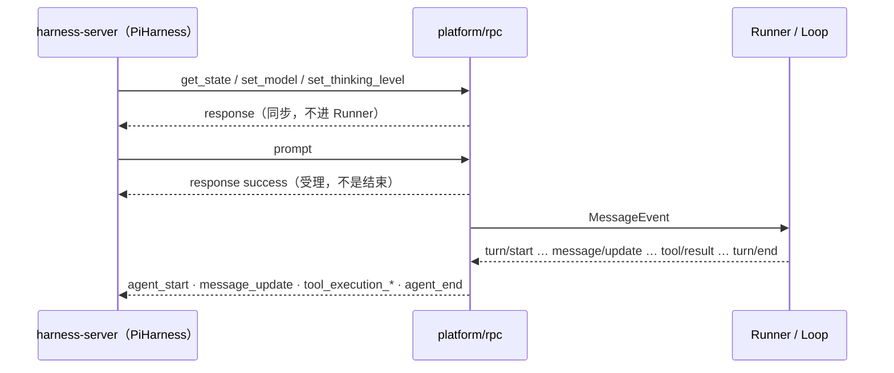
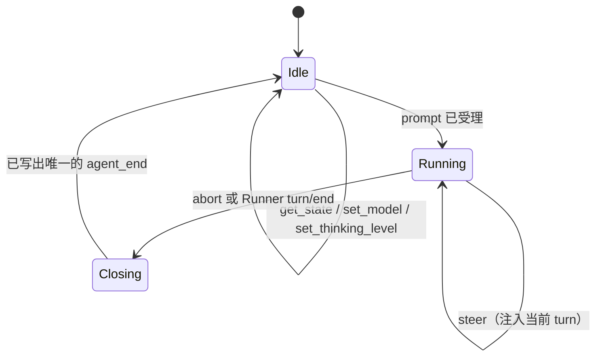

# AgentKit Pi RPC Platform 实施方案

> 受众：AgentKit 实现者。Centaur 只消费已经存在的 Pi blocks 路径，不改 Blocks。
> 行为标准：Centaur `harness-server` 的 `pi.rs`（命令字面量、终止、abort）。`centaur-pi-rpc.mjs` 只作参考，出现分歧时以 `pi.rs` 为准。
> 落地形态：只新增 `platform/rpc`。不改 Runner、LLM、`platform/cli`，不新增二进制。调用方在现有配置图里把 `platform.default` 换成这个 kind。

---

## 1. 要交付的东西

Centaur 把 AgentKit 当作 **Pi 桥子进程**：stdin 写入 LF-JSON 命令，stdout 读回 LF-JSON 事件。AgentKit 用一个进程同时做协议适配和 Agent 运行，对方把 `CENTAUR_NATIVE_CLI` 指到这个二进制即可接入。



进程边界只有一道。不在 `platform/cli` 外面再套翻译进程，也不把 Blocks 引进 AgentKit。

---

## 2. 范围

### 一期做

| 项 | 做法 |
| --- | --- |
| 命令 | `get_state` `set_model` `set_thinking_level` `prompt` `steer` `abort` |
| 事件 | `response` `agent_start` `message_update` `message_end` `tool_execution_start` `tool_execution_end` `agent_end` `centaur_error` |
| 文本 turn | 含多步工具循环；对外仍是 **一个** Pi turn（一次 `agent_end`） |
| 模型 | `set_model` 校验 provider 与允许列表。`deps.sessionStore` 实现了 `SessionRuntimeStore` 时，写入该会话的 model bind |
| effort | `set_thinking_level` 在平台内记住并应答。不改 LLM 请求 |
| 权限 | `Interactive=false` |
| 工具 | 不进协议。工具仍由现有配置图挂载 |

### 一期不做

- 附件 `images`（入站恒为空，忽略）
- `--resume` / `--native-session` / 把 AgentKit session 写成 Pi JSONL
- Codex app-server
- 改 `platform/cli`、改 Blocks、改 `PiHarness` normalizer
- 飞书 / TTY 交互审批

---

## 3. 进程与启动

平台自己不解析 Centaur 的 `--config` / `--session`。调用方用现有 `cmd/agent` 加载配置图，把 Pi 会话身份写进 `platform/rpc` 的 config：

```yaml
platform.default:
  use: platform/rpc
  config:
    sessionFile: /home/harness/agentkit/sessions/11111111-1111-1111-1111-111111111111.jsonl
    model: gpt-5.4
    modelProvider: acme
    baseUrl: https://models.acme.example/v1
    wireApi: openai-responses
    allowedModels:
      gpt-5.4-mini: null
  deps:
    sessionStore: sessionStore.default
```

`sessionFile` 不存在时创建空文件。`get_state.data.sessionFile` 回绝对路径。`sessionId` 是文件名去掉 `.jsonl`。入站 delivery 是 `rpc:<sessionId>`。文件里不写 Pi JSONL。

stdout 只写协议行。平台日志走 `slog`（进程已把默认 logger 接到 stderr）。

---

## 4. 代码放哪里

```text
runtime/platform/rpc/
  register.go     pluginkit.Register("platform/rpc", New)
  platform.go     stdin 循环、Receive/Send、命令
  codec.go        命令与事件的 JSON 结构
  turn.go         单个 Pi turn：timestamp、工具配对、一次 agent_end
  rpc_test.go
```

协议 DTO 只在这个包里。`set_thinking_level` 记在平台上。`set_model` 在 `deps.sessionStore` 同时实现 `SessionRuntimeStore` 时调用 `SetModelBind`。

形状对齐 `platform/acp`：`Receive` 阻塞在 inbox，`Send` 可并发，入站带 `Envelope.Route`。

---

## 5. stdout 规则

所有协议行共用一把写锁，一行一个 JSON，LF 结尾，`SetEscapeHTML(false)`。

| 规则 | 原因 |
| --- | --- |
| stdout 禁止日志、禁止空行、禁止非协议字节 | PiHarness 按行解析，脏字节会毁整轮 |
| `get_state` / `set_model` / `set_thinking_level` 的 `response` 在 turn 开始前写完，这三个 `id` 之后不再出现 | 再次出现会报 `Pi command correlation differs` |
| `prompt` / `steer` 先写 `response`，再把 `MessageEvent` 推进 inbox | Runner 只有 `Receive` 返回后才会开 turn，这样 `response` 一定在 `agent_start` 之前 |
| 禁止输出 `extension_error`、`agent_settled` | normalizer 直接报错 |
| 禁止把 `turn/end` 原样写成 `turn_end` | 对方忽略它，不能当终止 |

---

## 6. 命令状态机



### 6.1 握手（不进 Runner）

入站 `id` 原样回传。失败时 `success: false`，不发 `agent_start`。

| 入站 | 成功条件 | 动作 |
| --- | --- | --- |
| `{"id":"centaur.state","type":"get_state"}` | 进程已拿到 config 与 `--session` | 回 `data`：`sessionFile` = `--session` 绝对路径，`isStreaming=false`，`pendingMessageCount=0`，`sessionId` = 文件名 UUID，`model.id/provider/api/baseUrl` = 当前 model / `modelProvider` / `wireApi` / `baseUrl` |
| `{"id":"centaur.model","type":"set_model","modelId","provider"}` | `provider` 等于 config 的 `modelProvider`；`modelId` 等于 `model` 或 `allowedModels` 的键 | 记入平台状态，并对该 conversation 调用 `SetModelBind`。session 尚未创建时先记下，首轮 `prompt` 建会话后补写 |
| `{"id":"centaur.reasoning","type":"set_thinking_level","level"}` | `level` ∈ `off` `minimal` `low` `medium` `high` `xhigh` | 记入平台状态。下一次 `prompt` 起的 turn context 带上该 effort。对方没发这条命令时沿用 llm 配置 |

`get_state` 在 `Running` 时拒绝（`success: false`）。握手只发生在 turn 循环之前。

### 6.2 prompt

1. 写 `{"type":"response","id":"centaur.prompt","command":"prompt","success":true}`。
2. inbox 放入一条 user `MessageEvent`，`Message.Content` 为单段 text。`images` 忽略。
3. `Send` 看到 `turn/start` 后进入 `Running`，写出 `agent_start`。
4. 直到 `turn/end`，组装并写出唯一的 `agent_end`，回到 `Idle`。

`success: false` 只用于进程无法接受这条 prompt（例如已有 turn 在跑）。写完后本轮结束，不发事件。Runner 内部失败若发生在 `agent_start` 之前，改发 `centaur_error`（§6.5）；发生在之后，用 `agent_end` 收口。

### 6.3 steer

steer 的文本必须进 **当前** turn，不能再开一个 Pi turn。

- `Running`：写 `response`（`id=centaur.steer`，`command=steer`），再把 user `MessageEvent` 放进 inbox。Runner 在 session busy 时会 `Loop.Steer`，不会新开 `Dispatch`，因此不会第二次 `turn/start`。
- `Idle`：写 `success: false`。这时没有可注入的 turn，若放进 inbox 会被 Runner 当成新 turn，stdout 上会出现第二个 `agent_start`。

### 6.4 abort

1. 立刻写 `response`（`id=centaur.abort`，`command=abort`，`success: true`）。
2. 取 `turn/start` 时从 `KeySessionControl` 留下的 `Cancel`，调用 `Cancel(ctx, "aborted")`。
3. Agent 的 `turn/end` 仍会到来（`TurnEndData.Cancelled=true`）。`turn.go` 据此把最后一条 assistant 的 `stopReason` 写成 `aborted`，然后发 `agent_end`。
4. 若这时还没有 `agent_start`，立刻补 `agent_start` 和一条 `stopReason=aborted` 的 `agent_end`，并丢掉这个 Runner turn 后续的出站事件。已经 `agent_start` 时，等 `turn/end` 再写 `agent_end`。对方要求 abort 的 ack 和带 assistant 的 `agent_end` 缺一不可。

### 6.5 centaur_error

只在 **还没写 `agent_start`** 时使用：

```json
{"type":"centaur_error","id":"centaur.prompt","code":"pi_prompt_failed"}
```

`id` 只能是 `centaur.prompt` 或 `centaur.steer`，`code` 只能是 `pi_prompt_failed`。写出后本轮结束，后续事件丢弃。

---

## 7. 平台 config

平台不读 Centaur 的 `config.json`。调用方把其中需要回显和校验的字段写进 `platform/rpc` config。对应关系：

| 平台 config | 含义 |
| --- | --- |
| `sessionFile` | `--session` 路径。缺文件则创建空文件 |
| `model` / `modelProvider` / `baseUrl` / `wireApi` | `get_state.data.model` 的 `id` / `provider` / `baseUrl` / `api` |
| `allowedModels` | `set_model` 允许的 id；空则只允许 `model` |

`model`、`modelProvider`、`baseUrl`、`wireApi`、`sessionFile` 都必填，缺一则 `New` 失败。`set_model` 的 `provider` 必须等于 `modelProvider`。

Centaur 侧的 native 文件仍然长这样，由对方写入；本平台只消费已经映射进 YAML 的字段：

```json
{
  "version": 1,
  "harnessKind": "agentkit",
  "model": "gpt-5.4",
  "modelProvider": "acme",
  "baseUrl": "https://models.acme.example/v1",
  "wireApi": "openai-responses",
  "authEnvKey": "OPENAI_API_KEY",
  "authMode": "bearer",
  "allowedModels": {"gpt-5.4": null, "gpt-5.4-mini": null},
  "plugins": ["agenthub", "nex-tools"]
}
```

`authEnvKey`、`plugins`、`mcp.json`、`system-prompt.md` 不由本平台解析。密钥和工具仍走现有 LLM 与工具配置。

---

## 8. 出站映射

`AssistantMessageEvent.type` 的取值与 Pi 相同，这是内部增量事件。PiHarness **不消费** `message_update` 里的 `toolcall_*`，工具必须走独立的 `tool_execution_*`。`turn/end` 也不是 `agent_end`。映射做在 `turn.go`，不改 Agent 的 emit。

### 8.1 事件对照

| AgentKit `OutboundEvent` | stdout | 说明 |
| --- | --- | --- |
| `turn/start` | `{"type":"agent_start"}` | 每个 Pi turn 恰好一次，且先于任何 `message_update` |
| `message/start` | 不输出 | 只在组装器里分配本条 assistant 的 `timestamp`（从 1 递增的正整数，本条消息全程不变） |
| `message/update` 且 `text_delta` | `message_update` | `assistantMessageEvent` 原样嵌进 Pi 信封，外加 `message.role=assistant`、`message.timestamp`。同时把 delta 追加进该 timestamp 的正文缓冲 |
| `message/update` 且 `thinking_delta` | `message_update` | 同样嵌出。thinking 不进最终 `content` 的 text 段，单独累积成 `thinking` 段 |
| `message/update` 且 `toolcall_*` | 不输出 | PiHarness 丢弃这类增量 |
| `message/update` 且 `toolcall_end` | `tool_execution_start` | `toolCallId` = `ToolCall.ID`，`toolName` = 名称，`args` = `Input` 解出的对象；空则 `{}` |
| `message/end` | `message_end` | 用定稿 `ModelMessage` 覆盖缓冲。同一 `timestamp` 只发一次 |
| `tool/result` | `tool_execution_end` | 若这条 `toolCallId` 还没有 start，先补一条 start。`result.content` = `[{"type":"text","text": ToolResult.Content}]` |
| `turn/end` | `agent_end` | 见 §8.3。每个 Pi turn 恰好一次 |
| `permission/request` | 不输出 | `Interactive=false`，Broker 直接 `OutcomeNoHuman`，不应挂起 |
| 其他（`step/*`、`usage`、`todo/update`、compaction） | 不输出 | 不属于 Pi turn 事件 |

`message_update` 的形状：

```json
{"type":"message_update","message":{"role":"assistant","timestamp":17},"assistantMessageEvent":{"type":"text_delta","contentIndex":0,"delta":"…"}}
```

`contentIndex` 沿用内部值；缺失时写 0。大于 4096 的索引丢弃该条 delta（对方会拒）。

### 8.2 工具结果的 isError

`ToolResult.Audit["decision"]` 为 `deny`、`timeout`、`error`，或 `Audit["status"]=="failed"` 时 `isError: true`，否则 `false`。`isError` 必须是布尔，不能省略。

### 8.3 agent_end 与 stopReason

`agent_end.messages` 至少一条 `role=assistant`，schema：

```json
{"type":"agent_end","messages":[{"role":"assistant","timestamp":17,"model":"gpt-5.4","stopReason":"stop","content":[{"type":"text","text":"完整正文"}],"usage":{"input":4,"output":2,"cacheRead":0,"cacheWrite":0,"totalTokens":6}}]}
```

`content[]` 只允许：

| 来源 | Pi `type` | 字段 |
| --- | --- | --- |
| 文本缓冲 / `ContentPart` text | `text` | `text` |
| thinking 缓冲 | `thinking` | `thinking` |
| 本条消息上的 `ToolCall` | `toolCall` | `id` `name` `arguments` |

`usage` 有则用上表四个键；没有就省略整个对象。`model` 用本 turn 生效的 model id。

`stopReason` 只允许 `stop` | `length` | `toolUse` | `aborted` | `error`。取值：

| 条件 | stopReason |
| --- | --- |
| `TurnEndData.Cancelled` 或 abort 已发出 | `aborted` |
| `TurnEndData.Failed`，或 Run 报错 | `error` |
| 内部 stopReason 为 `length` | `length` |
| 其他，包括内部的 `empty`、`toolUse` | `stop` |

最后一条 assistant 不能以 `toolUse` 结束，否则对方报 `Pi completion before assistant settlement`。AgentKit 一个 turn 内部会多次「模型 → 工具 → 再模型」，这些工具用 `tool_execution_*` 表达；**整轮** `agent_end` 用最终那条 assistant，并把 `toolUse` 收成 `stop`。中间轮次的 assistant 只通过 `message_end` 定稿，不各自发 `agent_end`。

没有定稿正文时，`agent_end` 仍带一条 assistant：`content` 用已缓冲的 text；缓冲也没有则 `content: []`。

### 8.4 一轮最小序列

```text
← {"id":"centaur.state","type":"get_state"}
→ {"type":"response","id":"centaur.state","command":"get_state","success":true,"data":{…}}
← {"id":"centaur.model","type":"set_model","modelId":"gpt-5.4","provider":"acme"}
→ {"type":"response","id":"centaur.model","command":"set_model","success":true}
← {"id":"centaur.prompt","type":"prompt","message":"你好","images":[]}
→ {"type":"response","id":"centaur.prompt","command":"prompt","success":true}
→ {"type":"agent_start"}
→ {"type":"message_update","message":{"role":"assistant","timestamp":1},"assistantMessageEvent":{"type":"text_delta","contentIndex":0,"delta":"你好"}}
→ {"type":"agent_end","messages":[{"role":"assistant","timestamp":1,"model":"gpt-5.4","stopReason":"stop","content":[{"type":"text","text":"你好"}]}]}
```

有工具时，在 `agent_end` 之前成对写出 `tool_execution_start` / `tool_execution_end`。

---

## 9. 接到现有配置图

把上面的 `platform.default` 覆盖进当前图即可。权限是 `Interactive=false`，无人值守时沿用图里已有的 approval 与 policy。MCP 与工具不经过本协议。

`deps.sessionStore` 可省略。省略时 `set_model` 仍应答成功，并改变后续 `get_state` 与 `agent_end` 里的 model 字段，只是不写 runtime bind。

---

## 10. 权限与日志

| 项 | 行为 |
| --- | --- |
| Permission | `PermissionCapability.Interactive=false`。工具审批和 `ask_user` 走 `OutcomeNoHuman`，不等待 stdin |
| 日志 | `slog` → stderr。协议错误也走 stderr，stdout 只在需要时写 `response` / `centaur_error` / `agent_end` |
| 关停 | stdin EOF 或 SIGTERM：取消进行中的 turn，尽量补 `agent_end`（`aborted`），然后 `Runner.Stop` |

---

## 11. 测试

不依赖 Centaur 仓库。用脚本化的 stdin 和假的 outbound 序列断言 stdout 行。

| 用例 | 断言 |
| --- | --- |
| 握手 + 纯文本 | 与 §8.4 逐行一致；`get_state.data.model.*` 等于 config |
| `set_model` 非法 provider / 非法 modelId | `success: false`，无 `agent_start` |
| 工具一轮 | start/end 成对，`toolCallId` 相同；`agent_end.stopReason` 不是 `toolUse` |
| 内部多 segment | stdout 只有一个 `agent_start` 和一个 `agent_end` |
| abort | 先 `response`，后 `agent_end`，`stopReason=aborted`，且有 assistant 消息 |
| steer 在 Running | `response` 后无新的 `agent_start` |
| steer 在 Idle | `success: false`，无事件 |
| 重复 timestamp | 同一 timestamp 只定稿一次 |
| 禁止事件 | 输出里没有 `extension_error`、`agent_settled`、`turn_end`，握手 id 不在事件流里再次出现 |
| prompt 在已有 turn 时 | `success: false` |
| `agent_start` 之前失败 | 一条 `centaur_error`，没有 `agent_end` |

单测在 `runtime/platform/rpc/rpc_test.go`，不启动 LLM。

---

## 12. 状态

`platform/rpc` 已注册。单测覆盖握手、工具轮、abort、steer、忙时拒绝 prompt、`agent_start` 之前的 `centaur_error`。

对方要选 `harness: agentkit`，仍需自己做登记，并把子进程指到一份使用本平台的 AgentKit 配置。那部分不在本仓库。

---

## 13. 对方接入时需要知道的差异

| 项 | Pi native | 本进程 |
| --- | --- | --- |
| 进程 | `centaur-pi-rpc.mjs` | 现有 `agent` 进程，平台为 `platform/rpc` |
| 配置目录 | `~/harness/pi` | `~/harness/agentkit` |
| `harnessKind` | `pi` | `agentkit` |
| 协议与终止 | Pi RPC，`agent_end` 结束 | 相同 |
| 工具 | 对方注入 | 现有配置图挂载，协议不携带 |
| `wireApi` | 四种 | 平台原样回在 `get_state.model.api` |

---

## 14. 风险

| 风险 | 处理 |
| --- | --- |
| 把内部事件原样打到 stdout | 映射表是唯一出口；单测禁止 `turn_end` 与 `toolcall_*` 出现在线上 |
| steer 被 Runner 开成新 turn | Idle 拒绝；Running 才入队，依赖现有 busy → `Steer` |
| abort 只有 ack 没有 `agent_end` | `turn/end` 必达；没有 assistant 时补一条 `aborted` 消息 |
| stdout 被日志污染 | 平台不往 stdout 打日志；单测替换 stdout，非 JSON 行会解码失败 |
| effort 只回了 success 但模型没变 | 平台只记住 level。要影响采样需以后改 LLM，本期不做 |
