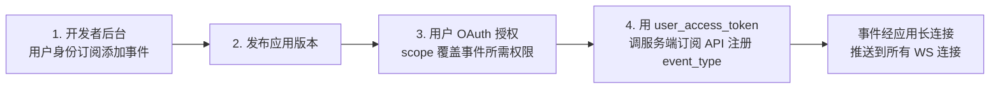

# Lark 用户身份事件订阅

本文记录 `platform/feishu`（含 `platform/lark`）接收**用户身份订阅事件**（妙记
`minutes.minute.generated_v1`、会议 `vc.meeting.participant_meeting_ended_v1`、
笔记 `vc.note.generated_v1` 等）的完整链路与运行时行为。

## 背景

飞书事件分两种订阅身份：

- **应用身份**：机器人自身上下文的事件（如 `im.message.receive_v1`），开发者后台
  订阅后即生效。
- **用户身份**：属于授权用户的事件（妙记生成、会议结束、日历/邮箱变更等）。仅在
  开发者后台添加事件**不会**产生任何推送——必须完成下述四步链路。

## 生效链路（四步缺一不可）



1. 开发者后台「事件与回调」→ 以**用户身份订阅**添加事件类型。
2. 发布应用版本（订阅变更随版本生效）。
3. 用户完成 OAuth 授权，scope 覆盖事件所需权限，例如：
   - `minutes:minutes.basic:read`、`minutes:minutes.artifacts:read`（妙记）
   - `vc:meeting.meetingevent:read`（会议结束）、`vc:note:read`（笔记）
4. **用该用户的 user_access_token 调服务端订阅 API 注册**（这一步是关系建立的关键，
   缺了它前三步全部静默无效）：

   | 事件 | 订阅 API | body |
   |---|---|---|
   | `minutes.minute.generated_v1` | `POST /open-apis/minutes/v1/minutes/subscription` | `{"event_type":"minutes.minute.generated_v1"}` |
   | `vc.meeting.participant_meeting_ended_v1` | `POST /open-apis/vc/v1/meetings/subscription` | `{"event_type":"vc.meeting.participant_meeting_ended_v1"}` |
   | `vc.note.generated_v1` | `POST /open-apis/vc/v1/notes/subscription` | `{"event_type":"vc.note.generated_v1"}` |

   示例（借助 lark-cli 的 user token）：

   ```bash
   lark-cli api POST /open-apis/minutes/v1/minutes/subscription \
     --body '{"event_type":"minutes.minute.generated_v1"}' --as user
   ```

订阅关系建立后，事件通过应用长连接**广播到该应用的所有 WebSocket 连接**，
agentkit 运行时接收不需要 user token，纯 bot 身份即可。

## agentkit 侧配置

```yaml
platforms:
  lark:
    plugin: platform/lark
    config:
      forwardEventsToAgent:
        - minutes.minute.generated_v1
        - vc.note.generated_v1
        - vc.meeting.participant_meeting_ended_v1
```

## 运行时行为

- **路由**：事件序列化为 `[事件] <type>\n<raw json>` inbound 消息直转 agent。
  每条事件使用独立 session（`sessionID = <platform>:evt:<event_id>[:u:<open_id>]`），
  避免同用户/同群多次事件共享对话历史。用户身份事件无 chat_id 时，回复仍按
  `subscriber_ids[0].open_id` 走 p2p（`replyContext.chat_id = open_id`）。
- **重启补送**：飞书对未 ack 的事件持续重推。停机期间发生的事件在进程重启、
  WS 重连后仍会送达——自定义事件**不按进程启动时间过滤**（与 IM 消息的
  `IsOldMessage` 策略不同），重复投递由 `event_id` 去重兜底。
- **多实例**：同一应用多个 WS 连接都会收到事件广播；agentkit 单进程内由
  `event_id` 去重，多进程部署时同一事件可能被各进程各处理一次。

## 注意事项

- lark-cli 的 `event consume` 会对同名事件做「注册-退出时退订」的生命周期管理；
  若同时用 lark-cli 调试消费同一事件，退出时会退订 agentkit 依赖的订阅关系，
  需要重新注册。
- 订阅关系是服务端持久状态，不随 token 过期或进程退出而消失，除非显式
  unsubscribe（各 API 有对应的 `DELETE .../subscription` 或 body 传
  `"event_type":""`）。
