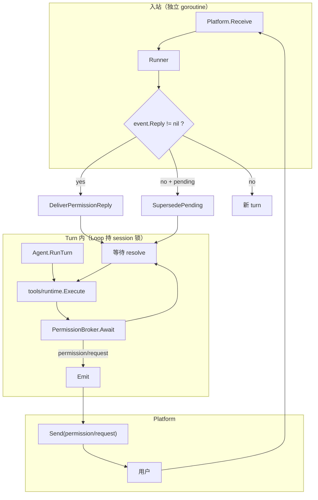

# Platform 人机交互（Permission 协议）

`ask_user`、工具审批、表单/多选统一走 **Permission 协议**（`cap/permission` + Loop `PermissionBroker`），对齐 cc-connect 的 pending + 入站分流模型。

> **Permission** 指「一次需要人类输入才能继续的裁决」，不限于权限检查——`ask_user` 的开放提问同样走这条通道。

## 架构



核心原则：

1. **入站与 turn 解耦**：turn 等待回复时 Runner 仍能 `Receive`。
2. **`Reply != nil` 不开新 turn**：Platform 回传 `MessageEvent.Reply`，Runner 投递给 Broker。
3. **同一 session 至多一个 pending**；`KindQuestion` 一次一题。
4. **无交互 platform 立即降级**：`Interactive=false` → `OutcomeNoHuman`，不挂 pending。

## 核心类型

```go
type Kind string
const (
    KindAllowDeny Kind = "allow_deny" // 工具是否允许执行
    KindQuestion  Kind = "question"   // ask_user / 单选 / 多选
)

type Request struct {
    ID       string
    Kind     Kind
    ToolCall *agentkit.ToolCall // allow_deny
    Question *Question          // question，仅一题
    Timeout  time.Duration      // 0 → EffectiveTimeout（交互平台默认 10 分钟）
    AskedBy  string
}

type Reply struct {
    RequestID    string
    UserID       string
    Decision     string         // allow_deny: allow/deny/y/n
    Selected     []int
    Text         string
    UpdatedInput map[string]any
    Cancelled    bool
}

type Outcome string
const (
    OutcomeResolved   Outcome = "resolved"
    OutcomeTimeout    Outcome = "timeout"
    OutcomeNoHuman    Outcome = "no_human"
    OutcomeCancelled  Outcome = "cancelled"
    OutcomeSuperseded Outcome = "superseded"
)

type Capability struct {
    Interactive    bool
    MultiSelect    bool
    DefaultTimeout time.Duration
    AnswerScope    AnswerScope // asker（默认）| anyone
}
```

`Capable` 由 **leaf** platform 实现；`multiplex` 经 `CapabilityRouter` 按 `PlatformID` 转发。

Broker 经 `KeySessionControl`（`*loop.Control`）注入；`tools/runtime` 与 `ask_user` 通过 `permission.BrokerFrom(ctx)` 获取。

### Session 级「全部允许」（allow_all）

allow/deny 请求除 `allow`/`deny` 外还支持第三个 decision `allow_all`（CLI 文本输入 `all`/`a`）。用户在**同一 session**（per-conversation `Control`）内回复 `allow_all` 后：

- 当前请求按 allow 裁决；
- 该 session 后续的 `KindAllowDeny` 请求不再发出 `permission/request`，Broker 直接返回 allow（reason `auto-allowed: allow_all for session`，slog 留痕）；
- `KindQuestion`（`ask_user` 等）不受影响，仍按原流程问人。

作用域仅当前 session，进程重启或换 session 即失效。各平台入口：CLI 提示 `[y/N/all]`；飞书 / Slack / chat-api 卡片渲染「全部允许」按钮；ACP 平台映射为 `allow_always` kind 的 PermissionOption。与 `approval/auto-allow` 的区别：后者是配置图级、对挂载 agent 的所有 session 生效；`allow_all` 是运行时逐 session 的人类授权，且 Policy plane 的 deny 裁决在 Broker 之前，不受影响。

## 事件

| Type | 含义 |
|---|---|
| `permission/request` | 开始等待人类输入 |
| `permission/resolved` | 结束等待（含 `Outcome`） |

`MessageEvent.Reply` 为 `json.RawMessage`，与 `Message` 互斥。

## Platform 接入

| 平台 | Capability | 展示 | 回传 |
|---|---|---|---|
| `platform/cli` | `Interactive`, `DefaultTimeout=10m`, `ScopeAnyone` | stderr prompt | `Receive` → `Reply` |
| `platform/feishu` | `Interactive`, `MultiSelect`, `DefaultTimeout≥10m` | 卡片 + 按钮 | callback 或 reply-to |
| `platform/slack` | 同上 | Block Kit 卡片 + 按钮 | 交互 payload |
| `platform/chat-api` | 默认 `Interactive=true`；`config.interactive: false` 降级为 headless | SSE `question_request` / debug 弹窗 | `POST /runs/.../respond` |
| `platform/acp` | `Interactive`, `DefaultTimeout=10m`, `ScopeAnyone` | ACP `session/update` 流式 chunk | ACP `request_permission`（Send 内同步） |
| `platform/rpc` | `Interactive=false` | Pi RPC stdout 事件 | 直接 `NoHuman` |
| `platform/headless` | `Interactive=false` | 无 | 直接 `NoHuman` |
| `platform/multiplex` | **转发 leaf Capability** | 按 `PlatformID` 路由 | 子平台 `Receive` 原样上送 |

`multiplex` 必须转发 leaf 的 `PermissionCapability()`，不能自己在 root 实现。

飞书 / Lark 确认卡（`ask_user` 选项、工具 allow/deny 的列表项）短选项仍是「文案 | 按钮」一行；**选项文案换行或超过约 16 字**时改为通栏说明 + 通栏按钮，避免窄列把长文本挤乱。确认后的静态卡标题只放短选项，长选项进正文「已选择」。

### 未知来源的交互卡回调

`platform/feishu`、`platform/lark` 与 `platform/slack` 可将用户点击**未走内置分流**的交互按钮，整理为带 `[card_action] … [/card_action]` 的入站文本并 **新开 turn**（无需额外 tool）。配置项 `unknownCardAction`：`forward`（默认）或 `ignore`（静默丢弃）。

内置分流（先匹配则不再 forward）：

| 前缀 / 类型 | 飞书 / Lark | Slack（`block_actions`） |
|---|---|---|
| `perm:` | Permission；回调响应内 Patch 确认卡 | Permission；`chat.update` 更新 Block 消息 |
| `nav:` / `act:` | 同步换卡或 toast；**不** forward | **未单独实现**；若 value 未识别会落入 unknown 规则 |
| `cmd:` | 异步入站命令正文 | 入站命令正文（经 inbox 入队） |
| 其它 | unknown forward / ignore | unknown forward / ignore |

#### 飞书 / Lark

适用场景含 Agent 经 lark-cli / Open API 发出的交互卡。

| 步骤 | 行为 |
|---|---|
| 拉取卡片 | 有 `open_message_id` 时 `Im.Message.Get`，`extractInteractiveCardText` → 可读 markdown |
| 拉取失败 | 仅格式化回调（`action` / `option` / `form_value` / `value` 等） |
| 会话 | 按钮 `value.session_key`，否则 `chat_id + user_id` delivery |
| 去重 | `message_id + 控件名 + action + form`，60s 内不重复入队 |
| 回执 | forward 成功或重复去重时 toast「已提交」 |
| 约束 | `allowFrom`、`allowChat` |

#### Slack

仅处理 `block_actions`（含 `value` 或 `selected_option`）。

| 步骤 | 行为 |
|---|---|
| 拉取卡片 | `conversations.history`（`latest` + `inclusive`，limit 1）解析 blocks / fallback 文本；需相应 history scope |
| 拉取失败 | 格式化 `action_id`、`value`、选项等 |
| 会话 | JSON `value` 内 `session_key`，否则 channel + user + thread 建 session |
| 去重 | `channel + message_ts + action_id + action + raw value`，60s 内不重复入队 |
| 回执 | 无额外用户可见提示（Socket Mode 已 Ack） |
| 约束 | `allowFrom`、`allowChannels` |

## 飞书流式进度卡片

`platform/feishu` / `platform/lark` 在 `enableFeishuCard: true`（默认）时展示 Card 2.0 交互卡。

**每轮一张回复卡**（`enableFeishuCard: true` 时），规则尽量简单：

| 阶段 | 耗时 | 完成感 |
|---|---|---|
| 进行中（工具/thinking） | 可折叠区：工具调用、结果、thinking 摘要；标题 `处理中 · N 个工具` / `思考中` | — |
| 进行中（纯对话） | 无折叠区 | — |
| 结束 | 折叠区保留为 `已调用 N 个工具` 等 + 正文首行 `☑️ 用时 …` | 用户原消息仍可用 `doneEmoji`；**不再**给机器人回复卡消息加 reaction |

`turn/end` 先关 CardKit 流式再整卡 Patch；仅正文变长且工具区未变时走 `main_text` 元素流式。整卡更新会关闭实体的流式模式，之后元素流式会报 **300309「streaming mode is closed」**——平台识别后在 state 里标记 `bodyStreamClosed`，本卡后续直接走整卡 patch，新建卡片时重置。同一 `card_id` 的 CardKit 写请求按「取 seq + HTTP 往返」整体串行（handle 级 `reqMu`），杜绝并发在途请求乱序落地被 **300317「sequence number compare failed」**拒绝；残留的 300317（响应丢失后同 seq 重试、或跨进程写同一实体）按**良性**处理——卡片内容单调累积，被拒的旧帧直接丢弃视为成功，不重试、不上抛。

**更新限频**：正文元素流式按 200ms 间隔 + 最小增量 20 字符节流，两个条件**同时满足**才立即 flush，否则由防抖定时器在间隔边界兜底一次——快模型高频 delta 下写请求速率同样被压到 1/interval，避免打满出口代理（TLB 403）。注意这是**有意比 cc-connect 更严格**的策略（cc-connect 是间隔/增量任一满足即 flush，打字机更顺滑但故障期请求更多）；Lark 元素流式限额为 50 QPS/元素，双条件压到的 5 QPS 仍远低于此。不满足元素流式条件时退化为 1.5s 整卡 patch 节流。

**空内容不建卡**：`buildRichCard` 在无折叠区且正文为空（非终态没有状态行可显示）时返回空串，调用方据此跳过建卡；`message/end` 对零输出消息段（如 ACP follow-up turn 无可见内容）在尚未建卡时直接跳过 flush——避免渲染出只有空 `main_text` 元素的空消息气泡。终态（☑️/已取消/出错）状态行始终保留，不受影响。

**失败降级与心跳**（更新模式，对齐 cc-connect）：卡片创建/更新失败（如出口代理间歇性 403）**不会中断 agent turn**，且**更新失败绝不中途重建新消息**——streamState 内容单调累积（每次 flush 渲染全量快照），跳过一帧什么都不丢，下一次成功 flush 把同一张卡补齐到最新；失败仅记日志（含连续失败计数 `updateFailCount`）并等下轮 flush / 心跳重试同一张卡。出口代理 / 边缘网关的非 JSON 响应（TLB 403/5xx 空 body，请求未到达 Lark 应用层）归类为 transient 错误退避重试，预算按调用方**分三档且整体保持短预算**：中途流式帧 quick（1 次重试、~1s 快速失败——内容单调累积，下一帧自动补齐，多重重试只会在故障期持续锤网关并长时间占用同卡写锁）；普通发送/消息 standard（2 次、~1.5s）；`turn/end` 定稿 patch finalize（3 次、~4s——只覆盖短暂抖动）。长故障窗口下快速走完降级链（另发最终卡 + 撤回旧卡 → 纯文本兜底），最终投递保证由纯文本的 5s/20s/60s 长重试覆盖，而不是让卡片路径在故障期长时间重试。创建失败带**指数退避**（2s 起步、上限 30s，成功清零），避免网关持续故障时每个流式 delta 都打一次创建 API；创建失败不产出任何消息，下轮 flush 重试创建。`turn/end` 定稿走**三级降级**保证最终答复不丢：patch 当前卡 → 失败则消息接口（`Im.Message.Patch`）挽救 → 再失败另发一张最终卡，**成功后随即撤回旧卡**（先发后撤：新卡已是完整答复，旧卡只是过时残影，撤回换来会话里只有一份答案；与中途更新保留旧卡的策略相反，因为那时旧卡是唯一内容）→ 最后纯文本补发，纯文本按 5s/20s/60s 重试，全部失败才记 Error 日志。卡片创建后若超过 10s 无任何更新（长 LLM 推理期间无出站流量，CardKit 实体可能被回收），心跳定时器会自动轻量 flush 一次（页脚 elapsed 随时间变化）保持卡片活跃；`turn/end` 定稿前停止心跳。

`enableFeishuCard: false` 时出站为纯文本。

```mermaid
flowchart TD
  start[turn/start] --> card[SendPreviewStart rich 卡]
  tool[tool / thinking] --> patch[UpdateMessage 整卡刷新]
  text[text_delta] --> patch
  end[turn/end] --> fin[最终 Patch + 关闭 streaming]
```

| 配置 | 默认 | 说明 |
|---|---|---|
| `showThinking` | `false` | 是否在进度区展示 thinking |
| `showToolProgress` | `true` | 是否展示 tool 调用名与参数摘要 |
| `asyncSubagentProgressCard` | `true` | `async` 委派子 Agent 时另发一张后台过程卡（生命周期独立于父 turn 回复卡） |
| `enableFeishuCard` | `true` | `false` 时回退纯文本出站 |
| `replyInThread` | `true` | 仅群聊出站时 `Im.Message.Reply` 带 `reply_in_thread`；私聊（p2p）始终平铺回复 |
| `threadNoMention` | `false` | 配合 `threadIsolation`：话题被 @bot 触发过（`activeThreadSessions`）后，话题内所有消息（含纯文字）免 @；默认仅纯附件免 @，纯文字仍需 @ |
| `replyToTrigger` | `true` | `false` 时不引用触发消息，改用 `Im.Message.Create` |

**整轮 turn** 的 thinking / tool / 正文都在同一张 rich 卡内刷新；同一 turn 内多条 assistant 消息的正文会在每条 `message/start` 时**定稿到累积区**（段间空行拼接），不会互相覆盖。出站流式状态优先按 Loop 打标的 `OutboundEvent.turnId` 隔离；无 `turnId` 时回退为 `delivery` + `Route.ReplyTo` 组合。IM 投递地址（delivery + replyTo）在首个出站事件时捕获进 stream state，心跳、防抖 flush、`turn/end` 定稿与纯文本兜底均从 state 读取，不依赖事件或额外缓存表。子 Agent 转发进度与 `subagent/start|end` 会带上父 turn id，异步委派在后台 goroutine 仍沿用捕获的父 turn id。`turn/end` 定稿时若流式正文为空，会用载荷里的 `message` 兜底。平台监听 `tool/result` 与 `subagent/start|end` 更新过程区。`renderProgressBody` 在面板 JSON 中默认仅保留最近 **2** 条 tool 行（超出显示「仅显示最近更新」），与 cc-connect 一致。

**异步子 Agent**（`delegate` + `async: true`）：父 turn 回复卡仍在 `turn/end` 定稿；子 Agent 在 `subagent/start`（`async`）时另发一张「后台子 Agent」过程卡，按 `OutboundEvent.AgentID` 与子 Agent 区分，刷新子 Agent 经 `forwardParentEmit` 转发的 **`toolcall_start` / `toolcall_end` / `tool/result`** 与**限长思考区内容**（原生 `thinking_delta`，以及 **ACP 等子 Agent 的 `text_delta` 重映射为 `thinking_delta`**，不进入主回复正文 lane），在 `subagent/end` 定稿。完整结论仍由 follow-up turn 以新消息送达。可通过 `asyncSubagentProgressCard: false` 关闭。该过程卡是 `streams` 里独立 key（父 streamKey + `:async:` + jobID）的普通 stream：正文由 `streamState.bodyFn` 自定义，**创建 / 刷新 / 心跳与父回复卡完全同一条 `flushRichCard` 路径**，平台层只保留事件路由。

```yaml
platform.default:
  use: platform/feishu
  config:
    showThinking: true
    showToolProgress: true
```

与 hermes-agent `display.*` 的对应关系：`tool_progress` → `showToolProgress`；`thinking_progress` → `showThinking`；过程与正文在同一张卡的两个面板中分别流式更新。

## 消息 Reaction（处理中 / 完成）

飞书 / Lark 与 Slack 在收到用户消息时会给原消息加「处理中」reaction；turn 结束（`turn/end`）或 slash 命令本地处理完成时，移除处理中 reaction，并视配置加上「完成」reaction。

| 平台 | 收到消息 | 被并入进行中 turn（steer） | turn 结束 |
|---|---|---|---|
| `platform/feishu` / `platform/lark` | `reactionEmoji`（默认 `OnIt`；`none` 关闭） | 该消息的处理中 reaction 替换为 `steerEmoji`（默认 `Typing`；`none` 关闭替换） | 用户消息：移除反应中的 reaction，添加 `doneEmoji`（默认 `CheckMark`）等；**`card`/`compact` 时不给机器人回复卡加 reaction**（卡片内已有 `☑️ 用时`） |
| `platform/slack` | `eyes` | 该消息的 `eyes` 替换为 `steerEmoji`（默认 `inbox_tray`；`none` 关闭替换） | 移除消息上的 reaction；按 `turn/end` 添加 `doneEmoji`（默认 `white_check_mark`）、取消时 `cancelledEmoji`（默认 `broken_heart`）、异常时 `errorEmoji`（默认 `x`）；同一 turn 内 steer 合并的多条用户消息会一并更新 |

### turn/steer：把「消息已并入当前回复」回报给发送者

用户消息到达时若该 session 已有 turn 在执行，runner 不再为它开新 turn，而是把它**并入**当前 turn（`Loop.Steer`）：Agent 在当前 step 结束后注入，或由 Loop 作为下一个 turn 消化。这条路径此前对发送者是静默的——只有平台侧的「处理中」reaction，看不出消息是被接收进当前回复还是排队成了下一条。

runner 现在会在 steer 成功后发一个 **`turn/steer`** 出站事件（payload `capsession.TurnSteerData`，`outcome: queued`），并且**带的是被并入消息自己的 route**（含 `replyTo` = 该消息 id），因此平台能精确标注这条消息。飞书 / Lark 与 Slack 都按同一事件处理：

- **飞书 / Lark**：把该消息的处理中 reaction（`reactionEmoji`）替换成 `steerEmoji`（默认 `Typing`）。新 reaction 的 id 会写回该消息在 **turn reaction batch** 中的记录，所以 `turn/end` 时移除的是替换后的 reaction。
- **Slack**：把该消息的 `eyes` 替换成 `steerEmoji`（默认 `inbox_tray`）。Slack reaction 没有 id，改由 batch 记录每条消息当前的 emoji 名，`turn/end` 据此移除。
- 消息不在进行中 turn 的 batch 里时（例如 turn 已在收尾）仍会做替换，只是不纳入 `turn/end` 的清理（Slack 此时无从记账，`turn/end` 会同时清 `eyes` 与 `steerEmoji`）。
- `steerEmoji: none` 可关闭替换，行为退回「只有处理中 reaction」。

配置示例（关闭替换）：

```yaml
platform.default:
  use: platform/feishu
  config:
    steerEmoji: none  # 关闭「已并入当前 turn」的 emoji 替换（飞书默认 Typing，Slack 默认 inbox_tray）
```

飞书 / Lark 默认开启 reaction，无需配置。关闭示例：

```yaml
platform.default:
  use: platform/feishu
  config:
    reactionEmoji: none  # 关闭处理中 reaction
    doneEmoji: none      # 关闭完成 reaction
    cancelledEmoji: none # 关闭取消 reaction（/stop 等，默认 HEARTBROKEN 💔）
    errorEmoji: none     # 关闭异常 reaction（默认 CrossMark）
```

Slack 结束态 emoji 配置（`none` 关闭对应项）：

```yaml
platform.default:
  use: platform/slack
  config:
    doneEmoji: none
    cancelledEmoji: none
    errorEmoji: none
```

Slack 在 `EventMessageStart` 后还会启动渐进式 typing reaction（`clock1` 等），`turn/end` 时一并清理。

## Slash 命令与 Platform 本地处理

飞书 / Lark、Slack、`platform/chat-api` 在消息**入队前**会经 `common.ProcessSlash` 本地解析 slash（含 `/help`、`/new`、`/stop`、`/me` 等）。未知命令会先提示「转发给 Agent」再入队。

`/me`（别名 `/whoami`）由 `runner` 贡献，返回当前用户身份：`uid` 取 `TurnEnvelope.Actor.UserID`，`name`/`email` 优先取 `Actor.Name`/`Actor.Email`，为空时回落到入站 metadata（飞书 / Slack 的 `displayName`/`email`，chat-api 的 `X-Chat-API-User-Name`/`X-Chat-API-User-Email` 请求头）。无任何身份信息时返回 `unknown user`。

若希望 **Platform 不拦截 slash**，将以 `/` 开头的用户输入当作普通对话交给 Agent（例如由模型自行理解或仅依赖 tool），在对应 platform 的 `config` 中设置：

```yaml
platform.default:
  use: platform/feishu
  config:
    disablePlatformSlash: true
```

该字段在 `common.AgentRoutingConfig` 上，对 `platform/feishu`、`platform/lark`、`platform/slack`、`platform/chat-api` 生效。**默认 `false`**（保持本地 slash）。`platform/cli` 仍始终本地处理 slash（含 turn 进行中的 `/stop`）。

开启后 **`/stop` 不再在入队前打断 turn**；需要取消进行中的 turn 时请用客户端/ACP 的 cancel 路径，或关闭该开关。

## 停止进行中的 Turn

`/stop` 由 `runner` 贡献，通过 `Loop.Cancel` 打断当前 session 正在执行的 turn（取消进行中的 step，并在下一步边界收尾）。与 `Steer` 不同，**不会**把消息注入对话历史。

**撤回消息自动取消（飞书 / Lark）**：用户撤回触发（或 steer 进）进行中 turn 的消息时，平台收到 `im.message.recalled_v1` 事件后对该 session 自动派发 `/stop`（`stopOnRecall` 默认 `true`，显式 `false` 关闭）。匹配基于进行中 turn 的 reaction batch（trigger + steer 消息），撤回与进行中 turn 无关的旧消息不影响执行；turn 已结束时撤回为无操作。该自动化不受 `disablePlatformSlash` 影响，取消后的 `turn/end` 表现（cancelledEmoji、流式卡「已取消」说明）与手动 `/stop` 一致。

| 平台 | 行为 |
|---|---|
| 飞书 / Slack / chat-api | slash 在入队前本地处理，turn 进行中也可 `/stop`（`disablePlatformSlash: true` 时 slash 仅作普通用户消息入队，无本地 `/stop`） |
| CLI | turn 进行中仅接受 `/stop`（及 `/exit`）；其他输入会暂存到 turn 结束后再处理 |

multiplex（CLI + IM 等）下，`/exit` 只关闭 CLI  stdin，**不会**结束 Lark / chat-api / 定时任务；要停整个进程请用 **Ctrl+C**（SIGINT）或 `kill -TERM` 目标 agent 进程。

**Ctrl+C / SIGTERM（默认）**：立刻 `CancelAllBackgroundReviews` + `CancelAllInFlight`，**不再**等待 `shutdownTimeoutSeconds`（你配置的 100s）；默认 `shutdownGraceSecondsOnSignal: 0` 即 abandoning in-flight turns，进程应很快出现 `agent shutting down` / `agent stopped`。若需要信号退出前留几秒收尾，可设 `runner.config.shutdownGraceSecondsOnSignal`（秒）。

正常 platform EOF 退出（无信号）仍受 `shutdownTimeoutSeconds` 约束。
| ACP | 客户端 `session/cancel` 走同一条 `Control.Cancel` 路径 |

无进行中的 turn 时返回 `no turn in progress`。

## 切换会话模型

`/model` 由 `loop/default` 贡献（loop 是 agent 目录属主），作用于 **coding agent**（`agent/coding`）的 LLM 请求，与会话 agent 覆盖一并写入会话目录下的 `runtime.json`。

slash 命令按领域由各自插件贡献（`/model` 由 `loop/default`，`/fallback` 由 `llm/fallback`，`/submodel` 由 `subagent/inprocess`），`commands/registry` 统一收集。

| 命令 | 行为 |
|---|---|
| `/model` | 显示当前生效模型、会话/全局覆盖与 agent 默认（接了 `deps.modelCatalog` 时附 `available: ...` 一行）；`/model show` / `status` 同义 |
| `/model <name>` | 将会话模型设为任意 provider 支持的模型名；不在目录中时给**非阻断**警告（自定义 baseUrl 模型仍合法） |
| `/model -g <name>` | 为**当前 agent** 设置全局默认（写入 `global:runtime.json` 的 `models`，所有未单独覆盖的会话生效） |
| `/model reset` | 清除本会话的模型覆盖 |
| `/model -g reset` | 清除当前 agent 的全局覆盖 |
| `/fallback [model]` | 由 `llm/fallback` 插件提供，只读展示 `fallbackOn`、配置的 fallback 模型与 attempt 链（`fb` 同义）；无参时主模型以 `<request model>` 占位，带模型名则按该主模型展开；列表来自 config，改 yaml 后需重启 |
| `/submodel` | 由 `subagent/inprocess` 插件提供，列出子 Agent 模型总览：wildcard、每个已定义子 Agent（含 md `model:` 优先提示）与遗留条目 |
| `/submodel <name> [model]` | 查看/设置/清除某个进程内子 Agent 的全局模型（写入 `global:runtime.json` 的 `models["sub:<name>"]`；子 Agent 名对定义列表校验，拼错会列出可用名单；md 定义里的 `model:` 优先于此设置）。`sub:<name>` 前缀是兼容别名 |
| `/submodel * <model>` | 给**所有子 Agent** 设全局 wildcard 模型（写入 `models["sub:*"]`，只影响子 Agent、不动主 agent；被 per-子键覆盖时让位）。`reset` 清除 |

与 `/agent use` 相同，会话模型绑定写在当前 active conversation（`/new` 子会话各自独立）。ACP 远程 agent 不使用模型覆盖。

**Agent 默认**：

| 命令 | 写入 | 生效范围 |
|---|---|---|
| `/agent use <id>` | 当前会话 `runtime.json` 的 `agentId` | 仅这段会话；`/new` 之后的新会话不继承 |
| `/agent -c use <id>` | 当前 channel（固定为频道粒度，如 `slack:C001`）在 session store 的 `agentId`；不论 `sessionScope` 是 channel/thread/user，同群各话题/用户共享同一条频道绑定 | 同群尚未设会话覆盖的会话（含其它话题）；`/new` 子会话仍继承（除非该子会话单独 `/agent use`） |
| `/agent -g use <id>` | `global:runtime.json` 的 `agentId` | 所有还没设会话或 channel 覆盖的 channel |
| `/agent reset`、`/agent -c reset`、`/agent -g reset` | 清除对应层 | — |

`-c` 与 `-g` 不能同时使用。优先级：会话 `runtime.json` → channel entry 的 `agentId`（旧部署可能仍从 `local:runtime.json` 只读回退）→ 全局 `global:runtime.json` → 请求里的 `agent_id` → `loop.defaultAgent`。会话、channel、全局 agent 绑定优先于 chat-api 请求体中的 `agent_id`。

`/model -g` 的全局条目按**当前路由到的 agent id**（含 `/agent -c use` 与 `/agent -g use`）写入 `global:runtime.json`，与 runner 入站解析一致。**会话级 `/model` 只作用于主 agent**：进程内子 Agent 的模型是显式配置（md `model:` → `/submodel <名>` → `/submodel *` → 父 agent 的 `-g`），不随会话内 `/model` 变化，见 [subagent.zh.md §模型解析](subagent.zh.md#模型解析进程内子-agent)。旧写法 `/model fallback` 与 `/model -g sub` 已分别迁移到 `/fallback` 与 `/submodel`，输入旧语法会报错并提示新命令。

**Agent 自主切换**：挂载 `tool/set-model` 后，Agent 可调用 `set_model` 写入同一会话 `runtime.json` 覆盖（下一 turn 生效，`allowModels` 白名单约束可选范围）；与 `agent/chain` 组合可实现「路由节点识别意图并切模型 → 主节点执行」的编排，见 [agent-chain.zh.md](agent-chain.zh.md)。

`platform/lark`（及 `platform/feishu`、`platform/slack`）的 `config.runnerSessionScope`（未设时回退 `sessionScope`）必须与 `runner.config.sessionScope` 一致，否则 slash（`/new`、`/model`）写入的 active entry / 会话模型绑定与 Runner 读取不一致。`sessionScope` 仍用于平台本地其它路由；不一致时 turn 可能锁在一种 session id 上，而 `/stop` 在另一种 id 上查 `IsSessionBusy`，会误判为无进行中的 turn。`/stop` 会按 delivery、scope 与 `/new` 子 session 等多种候选 id 匹配 busy session。群聊里若命令被解析成 `/stop@_user_x`，也会按 `stop` 处理。

`/agent -c` 不受此约束：channel 绑定固定按**频道粒度**读写（`ChannelEntryKey`），与 `sessionScope` 无关，因此设 `sessionScope: thread`（群话题级会话）时，在一个话题里 `/agent -c use` 也会对同群其它话题生效。

被取消的 turn 在 `turn/end` 时会携带 `cancelled: true`：飞书 / Lark 在**触发该 turn 的原消息**上移除处理中 reaction 并加上 `cancelledEmoji`（默认 `HEARTBROKEN` 💔），流式卡的处理过程/正文区追加「已取消」说明；Slack 在对应用户消息上移除 `eyes` 并加上 `cancelledEmoji`（默认 `broken_heart`），无流式卡时不另发说明消息。异常结束的 turn 使用 `errorEmoji`（飞书默认 `CrossMark`，Slack 默认 `x`）。不会误把 reaction 打到 `/stop` 命令消息上。同一 turn 内被 steer 合并处理的多条用户消息，会在 `turn/end` 时一并更新 reaction。

## 无人值守与 Policy 分工

| 场景 | 行为 |
|---|---|
| `approval/auto-allow` | runtime 短路 allow，不创建 pending |
| `approval/auto-deny` | runtime 短路 deny |
| `policy` deny | 不进入 Permission 平面 |
| headless / `Interactive=false` | allow_deny → deny；question → guidance |
| schedule fire turn | 出站仍走 delivery platform（如 chat-api `send`）；permission 强制 `Interactive=false`，`ask_user` 降级为 `NoHuman` |
| 超时 | `OutcomeTimeout`，按 kind 降级并**继续** turn；policy ask 的 tool result 含 `reason` + `guidance` |

`auto-allow` / `auto-deny` 只作用于 allow_deny；`KindQuestion` 始终走 Broker。

## chat-api 会话列表与 session 索引

L0 为 `platform.chat-api` 注入 `sessionIndex.default`（与 `tool/session-query`、background review 共用同一 SQLite FTS 索引）。

| 能力 | 数据源 | 说明 |
|------|--------|------|
| `GET /v1/conversations` | `session/sqlite-index` + session JSONL | 按 channel 过滤；列表顺序与索引 `MAX(seq)` 一致（`indexLastSeq`）；`updated_at` 取 JSONL 事件时间与索引 `LastMod`（文件 mtime）的较新者 |
| `chat-api/conversations/*.json` | 本地 JSON | 保留 `created_by`、`agent_id` 等 Chat API 专有字段；与索引合并展示 |
| `tool/session-search` | 同一索引 | FTS / list / scroll；租户 workspace 内跨会话 |

未配置 `deps.sessionIndex` 时，chat-api 回退为扫描 `sessions/` 目录（旧行为）。

## chat-api SSE 重连

SSE 连接与 run 解耦：客户端断开只 **detach** HTTP sink，agent turn 继续在后台执行。

| 操作 | 行为 |
|---|---|
| 客户端断开 SSE | run 保留在内存；缓存最后一个可恢复事件 |
| 重连 | `POST /v1/chat-messages`，body 带 `{"run_id":"run_xxx"}`（`user` / `channel` header 须与创建时一致） |
| 取消 run | `POST /v1/runs/{run_id}/cancel`（等同 `/stop`，与断开不同） |
| 交互回复 | `POST /v1/runs/{run_id}/interactions/{id}/respond`（SSE 可断开） |

入队用户消息或交互回复时，chat-api 将同一 `run_id` 写入入站 `metadata.turnId`（`agentkit.MetadataTurnID`），Loop 据此生成 turn 并在每条 `OutboundEvent.turnId` 上打标；平台出站按 **turn id** 关联 SSE run（同 session 多 run 时不再仅靠 delivery session 扫描）。`turn/end` 若携带 `message` 且流式 delta 未填满正文，会用作最终 `answerText` 兜底。

重连行为：

- run 存在且无活跃 SSE → 200，重放最后一个可恢复快照（`text_delta` / `thinking_delta` / `question_request` / `permission_request`，断线期间为 `replace:true` 全量），然后继续流式输出直至 `message_end`
- run 不存在或 user 不匹配 → 200，立即 `message_end`（graceful close）
- run 已有活跃 SSE → 409 `run already attached`

可恢复事件只保留**最后一个**；`tool_call` / `tool_result` / `file_ready` 等断线期间不重放。服务**重启**后 run 不恢复（见下节）。

## 超时与持久化

- 超时链：`Request.Timeout` → `Capability.DefaultTimeout` → 10 分钟。
- 等待 ≥ `permissionPersistAfterSeconds`（默认 60s）时 `permission/request` 落入 session 日志（审计用，模型不可见）。
- **不做跨重启 durable resume**：进程内 SSE 可重连；服务重启后 `session/recovery` 收尾悬挂 pending，补 orphan `tool/result`。

## 配置

```yaml
tool.ask-user.default:
  use: tool/ask-user

platform.chat-api:
  use: platform/chat-api
  deps:
    sessionIndex: sessionIndex.default   # 与会话列表、session_search 共用索引
  config:
  # interactive: false   # 无人值守 BFF：ask_user 降级为 NoHuman，不挂 SSE 提问

loop.default:
  config:
    permissionPersistAfterSeconds: 60
```

## 实现入口

`cap/permission/`、`runtime/loop/permission.go`、`runtime/runner/dispatch.go`、`runtime/tools/runtime.go`、`runtime/platform/cli/permission.go`

外部 ACP Agent 的权限请求经 `agent/acp-remote` 桥接到同一 Broker，见 [plugin-catalog.zh.md](../plugin-catalog.zh.md) §3.2 `agent/acp-remote`。

**`agent/acp-remote` 权限回传**：Broker 超时、用户拒绝或被新消息 supersede 时，桥接层向 ACP Agent 返回 `reject_once`（而非 `cancelled`），并在响应 `_meta` 中携带 `outcome` / `reason` / `guidance`，便于外部 Agent 自行决定跳过该工具后继续或结束 turn。仅 session/turn 取消（`session/cancel`、context abandoned）才回传 ACP `cancelled`。

## 外部卡片回调（Feishu/Lark、Slack）

通过 `lark-cli` 或其他外部工具发送的卡片，不一定属于 Permission 请求。
Feishu/Lark 的 `card.action.trigger`、Slack 的 Block Kit 操作与 modal 表单提交，
会转换成公共的 `cap/interaction.Event`。其他平台可以实现适配器复用同一处理链。

回调先检查已有用户/群聊白名单并去重，确认接收后在后台查询原卡片、恢复会话并处理操作。
Feishu 返回“已提交” toast，Slack 立即确认 Socket Mode 请求；网络查询与 agent 调度不会阻塞确认。
去重包含事件 ID（Feishu 的 `header.event_id`、Slack 的 trigger/action 标识）、操作人、会话目标、
控件、选项、输入与表单状态；缺少事件 ID 时回退到完整操作指纹。
传输去重只拦截重复投递；不同事件仍进入处理链，再由下述提交策略决定是否接受。
处理中会保留去重占位；只有实际消费或成功入队后才进入 60 秒完成窗口，投递失败会释放占位，允许重投。
该去重不保证跨进程或重启后的 exactly-once。

处理顺序：

1. Permission 操作继续进入 Permission Broker，绝不转为普通 agent 消息；残缺的 `perm:` 操作也不会兜底。
2. 内置命令/导航处理。`cmd:`、`act:`、`nav:` 共用命令执行器，保留用户资料及 Slack 命令中的 mention metadata；通过命令注册表判断是否实际处理，未知命令继续进入后续链路。
3. 按声明顺序调用 `deps.interactionHandlers` 子插件。
4. 未消费的操作按 `config.unknownCardAction` 转发 agent（`forward`，默认）或忽略（`ignore`）。`ignore` 不影响内置处理或子插件。

事件包含 `platform`、事件类型、操作人、消息 ID、会话和话题、控件答案（`value` 原始值及可解析的
`label` 显示文案）、完整卡片文本、`raw_card`、`raw_action` 和 `raw_callback`。
选项按控件名称匹配文案，值有歧义或无法匹配时保留原值。完整 JSON 作为数据保留，不依赖纯文本摘要。

`card_status` 明确区分 `available`（取得内容）、`unavailable`（消息/内容/查询客户端不可用）和
`failed`（查询报错）；后两者通过 `card_error` 说明原因。失败时仍传递答案和回调上下文。
卡片查询使用独立于投递的较短超时预算，避免查询超时直接取消答案投递。
最终入队另有独立的 30 秒预算；可选用户资料补充最多占用其中 2 秒，并遵守调用方取消信号。
队列仍不可用时会记录 `delivery failed` 并释放去重占位；只有成功入队才记录 `fallback forwarded`。
这是进程内的失败恢复机制，不提供持久化投递队列。

Feishu 优先使用经当前会话与操作人校验的卡片 `session_key` 或已知投递上下文，否则按原消息恢复话题。
开启话题隔离而查询失败、无法恢复话题时，使用按卡片消息 ID 隔离的临时会话，
并标记 `routing_status=isolated_card_fallback`，避免混入其他会话。
Slack 优先使用回调自带的原消息；需要查询话题回复时使用 replies API，并严格匹配消息时间戳。

### 自定义交互处理子插件

Feishu/Lark 与 Slack 的依赖均支持：

```json
{
  "deps": {
    "interactionHandlers": ["interaction-handler/my-question"]
  },
  "config": {
    "unknownCardAction": "forward"
  }
}
```

子插件通过 pluginkit 注册工厂，返回 `interaction.Handler`：

```go
import (
    "context"
    "github.com/lengzhao/agentkit/cap/interaction"
)

func (h *QuestionHandler) HandleInteraction(ctx context.Context, event interaction.Event) (bool, error) {
    if event.Action != "my_question_submit" {
        return false, nil // 继续后续插件和 agent 兜底
    }
    return true, h.saveAnswer(ctx, event) // 实际消费后才返回 true
}
```

插件必须支持并发调用并遵守 `ctx`。返回错误会记录日志并继续后续处理，避免插件故障丢失答案。
`true, nil` 表示已消费，不再转发 agent。Permission 卡片不会进入此接口。
Lark 原有 `deps.eventHandlers` 仍用于订阅其他开放平台事件，两类依赖互不替代。

Slack modal 如需关联原会话，可将按钮编码格式的 `{"session_key":"slack:…"}` 放入
`private_metadata`。缺少该信息时使用按 view ID 隔离的私聊会话；不将 modal 的 view ID 当作消息时间戳。

### 默认问题卡的一次性提交

仅未被内置处理或子插件消费、最终进入 agent 兜底的操作应用此策略：

- 首次最终提交在内存中原子占位，成功入队后保留标记；再次提交提示“已提交”，不再触发 agent。
- 成功入队后异步更新原卡片：保留标题、说明、布局和选项，禁用控件并追加所选答案。飞书使用原始卡片 JSON 原位禁用；Slack 无禁用属性，将控件转换成所在位置的只读展示，保留其他区块。更新失败会记录日志，服务端标记仍然拦截后续提交。
- 入队失败会释放占位，允许重新提交；agent 后续业务执行结果不影响卡片状态。
- `config.cardSubmissionTTL` 为正的 Go duration，默认 `24h`。完成标记超时自动清理，处理中占位保留至投递结束。重启不恢复标记；过期后仍可收到的旧交互可以再次提交。

默认普通按钮及独立选择控件为最终提交。原生表单中的修改、重置保留交互，提交按钮才提交；
Slack modal 的 `block_actions` 为修改，`view_submission` 为最终提交。`nav:` / `cmd:` / `act:` 默认为可重复操作。
原卡片不可用而无法判断控件用途时（飞书按钮也可能是表单重置），保留答案转发但不锁定、不关闭；卡片作者可以显式声明用途。

飞书按钮的 `value`、Slack action 的 JSON `value`（modal 使用 `private_metadata`）可以声明：

```json
{
  "agentkit_interaction": {
    "purpose": "submit",
    "mode": "once"
  }
}
```

`purpose` 支持 `submit`（最终提交）、`change`（修改，不转发 agent）、`navigation`（可重复操作）；
`mode` 支持 `once`（默认，按平台＋会话＋卡片限制）、`per_user`（再加操作人）、`repeat`（不限制）。
群内多人答题使用 `per_user`：保留共享卡片，向提交人发送个人回执；飞书发送私聊，Slack 使用 ephemeral。
这避免第一位答题人关闭所有人的控件。需要自定义多人卡片展示时交由插件处理。

子插件先于默认提交限制执行。返回 `true, nil` 后，平台不会设置一次性标记，也不会自动关闭卡片；
插件自行控制长期交互、重复提交与状态。需要关闭时可以调用：

```go
if err := interaction.CloseCard(ctx, "已收到你的答案"); err != nil {
    return true, err
}
return true, nil
```

空文本使用默认的提交答案摘要；原有问题保留在卡片原位置，避免重复展示。该接口只更新展示，不设置默认提交标记；插件需要自行防重。
飞书查询显式使用 `card_msg_content_type=user_card_content` 获取原始结构；原始结构不可用或含无法安全禁用的控件时，保留现有卡片并记录更新失败，不用摘要整卡覆盖。
Slack 原生 modal 最终提交仍遵循 Slack 的确认关闭行为；插件主动关闭仍在展示的 modal 时，保留原题目标题及会话元数据并移除提交入口。消息卡片由插件决定何时更新。
