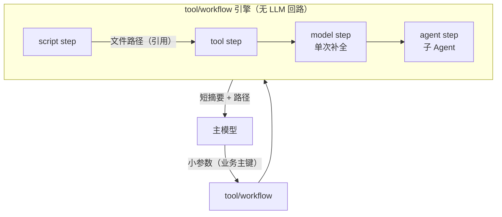

# Workflow 编排（tool/workflow）

本文描述 `tool/workflow`：把**脚本、工具调用、单次补全、子 Agent** 串成声明式管线，固化在 workflows 目录下的独立文件里。整条管线在工具侧一次执行完毕，中间数据不经过主对话模型——解决"大 JSON 经模型读入再编成 tool 参数"造成的延迟与卡死。

相关文档：[agent-chain.zh.md](agent-chain.zh.md)（Agent 级编排）、[subagent.zh.md](subagent.zh.md)、[tools.zh.md](tools.zh.md)（MCP / OpenAPI 动态工具）。

## 1. 定位



| 对比 | 层级 | 数据是否过主模型 |
|---|---|---|
| `agent/chain` | Agent 级，每节点是完整 LLM turn | 过 |
| `tool/subagent`（delegate） | 模型自主委派 | 子上下文内过，主对话只回 summary |
| pi `codemode` | 模型临时写脚本编排 | 不过，但流程不固化 |
| **`tool/workflow`** | Tool 级，声明式固化管线 | **不过（不变量）** |

**不变量**：主对话上下文不接触大 payload。任何 step 类型都不允许把超上限的数据渲染进主模型可见的输入/输出。

## 2. workflows 目录

与 `agents/*.md` 的 subagent 模式同构：**一个目录、一个文件一个 workflow**。默认目录为租户 `work/workflows/`，可用 `local:`/`global:` 前缀叠加（先命中者赢，同 `mcp.json`）。

```
workflows/
├── buyback_ledger.json     # 一个文件 = 一个 workflow，name 取文件名（去扩展名）
├── daily_report.json
└── scripts/                # 与 workflow 文件同级，script step 相对此目录解析
    └── gen_ledger.py
```

单文件格式：

```json
{
  "description": "生成回购账本并写库",
  "inputs": {
    "type": "object",
    "properties": { "date": { "type": "string" } },
    "required": ["date"]
  },
  "steps": [
    { "id": "gen", "type": "script",
      "run": "python3 scripts/gen_ledger.py {{ .inputs.date | quote }} --out {{ .workflow.runDir }}/ledger.json" },
    { "id": "check", "type": "model",
      "model": "gpt-4o-mini",
      "prompt": "校验账本统计并输出 JSON：{{ .steps.gen.stdout }}",
      "outputSchema": { "type": "object", "properties": { "ok": { "type": "boolean" } } },
      "maxInputBytes": 16384 },
    { "id": "audit", "type": "agent",
      "agent": "auditor",
      "task": "审计账本文件 {{ .workflow.runDir }}/ledger.json，输出问题清单",
      "timeoutSeconds": 600 },
    { "id": "submit", "type": "tool",
      "tool": "ledger__import",
      "args": { "path": "{{ .workflow.runDir }}/ledger.json" } }
  ],
  "result": "账本 {{ .workflow.runDir }}/ledger.json 已写库，状态 {{ dig .steps.submit.json \"status\" }}"
}
```

| 字段 | 说明 |
|---|---|
| `description` | 工具描述；汇集进 `workflow` 工具的描述文本供模型选路 |
| `inputs` | JSON Schema；`args` 在执行前按此校验，校验失败作为工具错误返回（模型可修正重试） |
| `steps[]` | 串行执行；`id` 在模板上下文中引用 |
| `result` | 模板，渲染后作为工具结果返回给主模型（走既有 spill 截断） |

script step 的 `run`、`dir` 里的相对路径，相对**该 workflow 文件所在目录**解析（脚本与管线同仓管理）；step 产物写每次运行的 artifact 目录，模板经 `{{ .workflow.runDir }}` 引用（workspace `work/workflow/<run>/`，引擎在运行开始时创建）。

## 3. Step 类型

### 3.1 `script`：脚本

经 sibling `ToolRuntime` 调用 **`bash` 工具**（`tool/shell-bash`）：与模型手调 bash 同一条执行、截断与 spill 语义；`run` 渲染后包成 `cd <dir> && …`（`dir` 默认 workflow 文件所在目录）。`deps.runtime` 必须挂载 `bash`。

| 字段 | 说明 |
|---|---|
| `run` | 模板渲染后的 shell 片段（在 `dir` 下执行） |
| `timeoutSeconds` | 传给 bash 的 `timeout`（秒）；未设则用 bash 插件默认 |
| `dir` | 工作目录，默认该 workflow 文件所在目录 |

bash 返回的合并输出写入 `.stdout` / `.text`；若 bash 已 spill，从 `Full output:` 解析 `.path`，超大时引擎另写 `{{ .workflow.runDir }}/<step>.out` 作 workflow 侧引用。非零退出、超时、取消 fail step。

### 3.2 `tool`：工具调用

调用内置 tool / MCP / OpenAPI 工具。**必须经 sibling `ToolRuntime` 执行**，policy / approval / hooks 这条 enforcement plane 对 step 照常生效——这是与"脚本里自己 curl"的本质区别。

| 字段 | 说明 |
|---|---|
| `tool` | 模型侧清洗后的工具名（如 `ledger__import`） |
| `args` | object，叶子字符串递归按模板渲染；标量原样保留 |
| `timeoutSeconds` | 默认随 runtime |

工具结果是合法 JSON object/array 时自动解析进 `.steps.<id>.json`（可 `dig`），`.text` 始终是结果文本（超 50KB 同样 spill 出 `.path`）。

### 3.3 `model`：单次补全

函数式 LLM 调用：**无 tools、无 hooks、无 session 事件**。用于判断、分类、格式转换。

| 字段 | 说明 |
|---|---|
| `model` | 模型名，传给 `deps.llm` 注入的 provider（与 `tool/recognize` 同模式）；空用 provider 默认 |
| `prompt` | 模板渲染；**渲染结果超 `maxInputBytes`（默认 16KB）直接 fail step**，不静默截断 |
| `outputSchema` | 可选；声明则以 system 指令约束 JSON 输出并校验，下游经 `.steps.<id>.json` 取值，否则 `.text` |
| `maxInputBytes` | 守住"大 JSON 不过模型"底线的强制上限 |

`outputSchema` 的典型用法是**格式转换**：script step 产出的摘要经 model step 转成下游工具要求的精确结构，结果直接拼进 tool step 的 `args`：

```json
{ "id": "convert", "type": "model", "model": "gpt-4o-mini",
  "prompt": "把账本统计转换为写库格式：{{ .steps.gen.stdout }}",
  "outputSchema": {
    "type": "object",
    "properties": {
      "ledgerId": { "type": "string" },
      "entries":  { "type": "integer" },
      "checksum": { "type": "string" }
    },
    "required": ["ledgerId", "entries", "checksum"]
  } },
{ "id": "submit", "type": "tool", "tool": "ledger__import",
  "args": { "path": "{{ .workflow.runDir }}/ledger.json", "meta": "{{ .steps.convert.json }}" } }
```

`{{ .steps.convert.json }}` 直接渲染为紧凑 JSON（复合值经 `dig` 逐层取值）。模型输出不符合 `outputSchema`（或非 JSON）时 step 失败，不静默降级为文本，错误可经 `continueOnError` 裁决。

### 3.4 `agent`：子 Agent

经 `cap/subagent.Spawner` 委派完整 agent turn，子 Agent 可带自己的 tools 多步执行。

| 字段 | 说明 |
|---|---|
| `agent` | 子 agent 定义名 |
| `task` | 模板渲染的自包含指令（子 session 为空，所需事实必须写入） |
| `timeoutSeconds` | 默认 900；同时受宿主 `toolTimeouts` 口径约束 |

语义约束：

- **强制同步**（`Async=false`）：引擎等 `Result.Summary` 才进下一步；async 的 follow-up turn 投递不属于管线语义
- 深度限制（`:sub:` 计数）与"子 agent 运行时不挂 delegate"天然继承，无新机制
- `deps.subagent` 为可选依赖；未接线时 agent step 在执行期报 `agent step requires a subagent dependency`（model step 对 `deps.llm` 同理）

**agent step 是"模型必须消化大正文"的正规泄压阀**：子 Agent 与主 Agent 共享 workspace 但上下文隔离，task 里传文件路径，子 Agent 在自己上下文里读整份数据，只有 summary 回到 workflow。

## 4. 数据传递：by reference 优先

模板引擎用 `text/template`，funcmap 保持极小：`dig`（JSON 取值）、`quote`、`join`。不引 sprig，不暴露文件读写函数。

模板上下文：

```
.inputs.<name>            # 主模型传入的小参数
.workflow.name/.dir       # workflow 名与文件所在目录（脚本同仓路径）
.workflow.runDir          # 本次运行 artifact 目录（work/workflow/<run>，引擎已创建）
.steps.<id>.stdout/.text  # 截断视图（小数据 by value）
.steps.<id>.path          # 全文文件路径（大 payload by reference）
.steps.<id>.json          # model/tool step 的结构化输出；直接渲染为紧凑 JSON，dig 逐层取值
.steps.<id>.status        # ok / error
.steps.<id>.session       # agent step 的子 session id（审计）
```

约定：

- **大 payload 一律 by reference**：step 输出超阈值写 `work/workflow/<run>/<step>.out`，下游引用 `.path`，工具/脚本自己读文件
- **小数据 by value**：经 `dig` 从结构化输出取字段
- step 中间态只在内存 + workspace，不进 session 事件流，主模型不可见

## 5. 执行语义

| 项 | 行为 |
|---|---|
| 控制流 | v1 仅串行；并行/分支待真实需求再加 |
| 失败 | 默认中止整轮，`continueOnError: true` 可选；错误带已完成 step 摘要，不带 payload |
| 超时 | per-step `timeoutSeconds` + 整体 ctx 透传；workflow 工具自身超时需覆盖最长管线 |
| 取消 | `/stop` 经 ctx 中止当前 step，管线随之中止 |

## 6. 审计与观测

嵌套 step 不产生模型可见消息，但必须留痕：

- telemetry：每次运行一个 `workflow.run` 事件、每 step 一个 `workflow.step` 事件（attrs：workflow / run_id / step / type / status / duration_ms / 截断 error）；失败另有 `slog.Warn`
- session 自定义事件待真实消费者（如离线审计）出现再加，不为未来需求预留契约
- workflow 的 `result` 渲染输出是主模型唯一可见内容，满足 "Model-visible ⟺ Logged"

## 7. 装配

`tool/workflow` 是**单个静态工具**（工具名 `workflow`），模型按名调用：

```json
{ "name": "buyback_ledger", "args": { "date": "2026-10-13" } }
```

- `name`：workflow 文件名（去扩展名）；`args`：对应该 workflow 的 `inputs`
- 工具描述由引擎动态汇集：**每个 workflow 一段（name + description + inputs 摘要）**，与 subagent 靠 `prompt/section/subagents` 列名单同理；`args` 在工具侧按 `inputs` schema 校验，非法即返回校验错误（模型可修正重试），不进入管线
- 目录按调用重读（同 subagent `Definitions` 每次调用重读）：编辑 workflow 文件**即改即生效**，无需 `/workflow -u`

```yaml
tool.workflow.default:
  use: tool/workflow
  config:
    dirs:
      - local:workflows        # 租户 work/workflows/，默认
      - global:workflows       # 全局共享，先命中 local 赢
  deps:
    runtime: tools.runtime.workflow   # 兄弟实例，不含 tool/workflow 自身（防环，同 tool/subagent 模式）
    workspace: workspace.default
    llm: llm.fast                      # 可选，model step 用（单实例 + step 的 model 字段，同 tool/recognize）
    subagent: subagent.default         # 可选，agent step 用
    telemetry: telemetry.default       # 可选，workflow.run / workflow.step 事件
```

- 引擎与插件同包 `plugins/tool/workflow`（解析、调度、模板、step 执行与 `pluginkit` 注册）；script step 不单独起进程，只调 sibling runtime 的 `bash`
- `/workflow` 命令列出已发现的 workflow（来源目录、step 数），仅为人读，不经模型

与"每 workflow 一个动态工具（ToolProvider）"的形态相比，`name + args` 单工具放弃了 per-workflow 静态 input schema，换来：新增 workflow 零配置图改动、工具列表不随目录膨胀、`tools/deferred` 下只有一个常驻工具——与 `delegate`、`skill` 的取舍一致。

## 8. 场景路径速查

| 场景 | 路径 |
|---|---|
| 模型不需要看数据 | script → tool，纯引用传递 |
| 模型看蒸馏后的小数据 | `model` step（`maxInputBytes` 强制上限） |
| 模型必须消化大正文 | `agent` step：传路径，子上下文读，只回 summary |

三条路径下主对话上下文都不接触大 payload。
