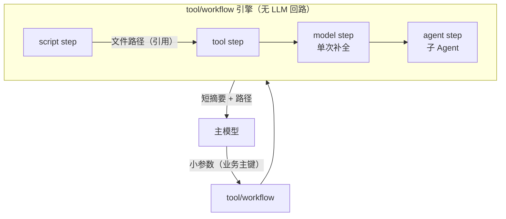
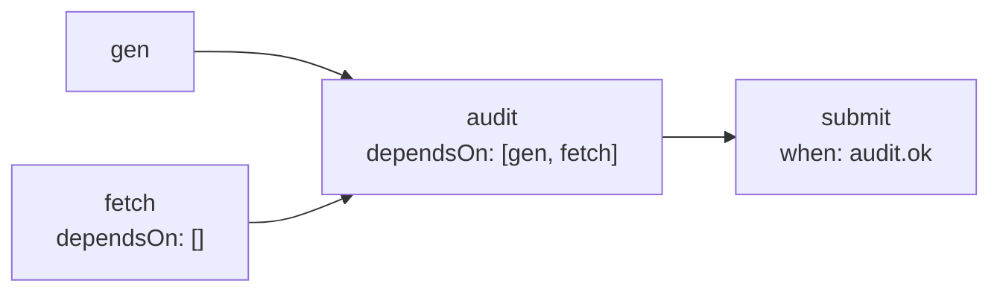
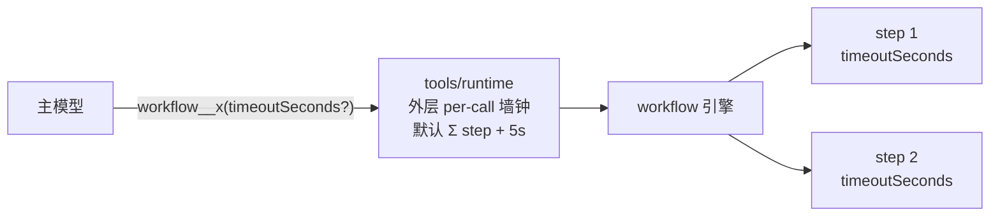

# Workflow 编排（tool/workflow）

本文描述 `tool/workflow`：把**脚本、工具调用、单次补全、子 Agent** 串成声明式管线，固化在 workflows 目录下的独立文件里。整条管线在工具侧一次执行完毕，中间数据不经过主对话模型——解决"大 JSON 经模型读入再编成 tool 参数"造成的延迟与卡死。

相关文档：[agent-chain.zh.md](agent-chain.zh.md)（Agent 级编排）、[subagent.zh.md](subagent.zh.md)、[tools.zh.md](tools.zh.md)（MCP / OpenAPI 动态工具）。

## 1. 定位



| 对比 | 层级 | 数据是否过主模型 |
|---|---|---|
| `agent/chain` | Agent 级，每节点是完整 LLM turn | 过 |
| `tool/subagent`（delegate） | 模型自主委派 | 子上下文内过，主对话只回 summary |
| pi `codemode` | 模型临时写脚本编排 | 不过，但流程不固化 |
| **`tool/workflow`** | Tool 级，声明式固化管线 | **不过（不变量）** |

**不变量**：主对话上下文不接触大 payload。任何 step 类型都不允许把超上限的数据渲染进主模型可见的输入/输出。

## 2. workflows 目录

与 `agents/*.md` 的 subagent 模式同构：**一个目录、一个文件一个 workflow**。默认目录为租户 `work/workflows/`，可用 `local:`/`global:` 前缀叠加（先命中者赢，同 `mcp.json`）。

模型侧不直接看到 `local:`/`global:` 词汇：`config.base.yaml` 的 `prompt.workspace-dirs.default`（`prompt/section/workspace-dirs`）每轮把扫描目录解析成本会话的绝对路径（含多租户 local 根）与优先规则注入 system prompt，agent 据此知道在哪读、在哪新建。覆盖 `tool/workflow` 的 `config.dirs` 时同步更新该 section 的 entries。

```
workflows/
├── buyback_ledger.json     # 一个文件 = 一个 workflow，name 取文件名（去扩展名）
├── daily_report.json
└── scripts/                # 与 workflow 文件同级，script step 相对此目录解析
    └── gen_ledger.py
```

单文件格式：

```json
{
  "description": "生成回购账本并写库",
  "inputs": {
    "type": "object",
    "properties": { "date": { "type": "string" } },
    "required": ["date"]
  },
  "steps": [
    { "id": "gen", "type": "script",
      "run": "python3 scripts/gen_ledger.py {{ .inputs.date | quote }} --out {{ .workflow.runDir }}/ledger.json" },
    { "id": "check", "type": "model",
      "model": "gpt-4o-mini",
      "prompt": "校验账本统计并输出 JSON：{{ .steps.gen.stdout }}",
      "outputSchema": { "type": "object", "properties": { "ok": { "type": "boolean" } } },
      "maxInputBytes": 16384 },
    { "id": "audit", "type": "agent",
      "agent": "auditor",
      "task": "审计账本文件 {{ .workflow.runDir }}/ledger.json，输出问题清单",
      "timeoutSeconds": 600 },
    { "id": "submit", "type": "tool",
      "tool": "ledger__import",
      "args": { "path": "{{ .workflow.runDir }}/ledger.json" } }
  ],
  "result": "账本 {{ .workflow.runDir }}/ledger.json 已写库，状态 {{ dig .steps.submit.json \"status\" }}"
}
```

| 字段 | 说明 |
|---|---|
| `description` | 工具描述；即 `workflow__<name>` 工具的模型侧描述，供模型选路 |
| `inputs` | JSON Schema；`args` 在执行前按此校验，校验失败作为工具错误返回（模型可修正重试） |
| `steps[]` | 默认按文件顺序串行；声明 `dependsOn` 后按 DAG 分层、同层并行（见 §3.5）；`id` 在模板与依赖中引用 |
| `result` | 模板，渲染后作为工具结果返回给主模型（走既有 spill 截断） |

script step 的 `run`、`dir` 里的相对路径，相对**该 workflow 文件所在目录**解析（脚本与管线同仓管理）；step 产物写每次运行的 artifact 目录，模板经 `{{ .workflow.runDir }}` 引用（workspace `work/workflow/<run>/`，引擎在运行开始时创建）。

## 3. Step 类型

### 3.1 `script`：脚本

优先经 **`deps.shell`**（`tool/shell-bash` 的 StructuredShell 能力）直接执行，返回原始 stdout/stderr/exit code，不解析模型文案；`run` 渲染后包成 `cd <dir> && …`（`dir` 默认 workflow 文件所在目录）。未注入 `deps.shell` 时回退为经 sibling `ToolRuntime` 调 **`bash`** 工具并解析文本（仅兼容用，不推荐）。`deps.runtime` 仍用于 `tool` step。

| 字段 | 说明 |
|---|---|
| `run` | 模板渲染后的 shell 片段（在 `dir` 下执行） |
| `timeoutSeconds` | 传给 shell 的 timeout（秒）；未设则用插件默认 |
| `dir` | 工作目录，默认该 workflow 文件所在目录 |

合并输出写入 `.stdout` / `.text`；超 50KB 时引擎写 `{{ .workflow.runDir }}/<step>.out` 并暴露 `.path`。非零退出、超时、取消 fail step——bash 回退路径下 runtime 把超时转成哨兵文本（`tool execution timed out`，见 [tools.zh.md](tools.zh.md)）时同样按失败处理，不会误记为 `ok`。

### 3.2 `tool`：工具调用

调用内置 tool / MCP / OpenAPI 工具。**必须经 sibling `ToolRuntime` 执行**，policy / approval / hooks 这条 enforcement plane 对 step 照常生效——这是与"脚本里自己 curl"的本质区别。

| 字段 | 说明 |
|---|---|
| `tool` | 模型侧清洗后的工具名（如 `ledger__import`） |
| `args` | object。叶子字符串按模板渲染；渲染结果若是 JSON object/array，解析成对象/数组再传给 tool。数字保持 JSON 字面量（`json.Number`），不会先变成 `float64` |
| `timeoutSeconds` | step ctx 墙钟；默认随 runtime。sibling runtime 的 per-tool 超时哨兵（`tool execution timed out`）同样 fail step |

工具结果是合法 JSON object/array 时自动解析进 `.steps.<id>.json`（可 `dig`），`.text` 始终是结果文本（超 50KB 同样 spill 出 `.path`）。script step 的 stdout 同样：整段输出是 JSON object/array 时写入 `.steps.<id>.json`。

需要把文件或上一步的 JSON **作为 object 参数**交给 tool（schema 的 `type: object`，没有 path 字段）时，叶子写成整段 JSON，引擎解析后再编码，避免 payload 变成 JSON 字符串：

```json
{ "id": "build", "type": "script",
  "run": "python3 scripts/build.py --out {{ .workflow.runDir }}/payload.json" },
{ "id": "update", "type": "tool", "tool": "capitaldesk_update_dataset",
  "args": {
    "datasetKey": "dailyData",
    "expectedVersion": "{{ dig .steps.prev.json \"version\" }}",
    "payload": "{{ readJSON (printf \"%s/payload.json\" .workflow.runDir) }}"
  } }
```

`payload` 收到的是对象。文件里的整数（含超过 2^53 的整数）按原文传递，不会先变成 `float64` 再四舍五入。`readJSON` 只允许读取该 workflow 文件所在目录和本次 `runDir`。上一步 stdout / tool 结果已是对象时，直接写 `"payload": "{{ .steps.build.json }}"`。叶子只有一段插值且结果是 JSON 数字时按数字传入（如上面的 `expectedVersion`）。静态字符串 `"42"` 和路径、备注仍是字符串。

### 3.3 `model`：单次补全

函数式 LLM 调用：**无 tools、无 hooks、无 session 事件**。用于判断、分类、格式转换。

| 字段 | 说明 |
|---|---|
| `model` | 模型名，传给 `deps.llm` 注入的 provider（与 `tool/recognize` 同模式）；空用 provider 默认 |
| `prompt` | 模板渲染；**渲染结果超 `maxInputBytes`（默认 16KB）直接 fail step**，不静默截断 |
| `outputSchema` | 可选；声明则以 system 指令约束 JSON 输出并校验，下游经 `.steps.<id>.json` 取值，否则 `.text` |
| `maxInputBytes` | 守住"大 JSON 不过模型"底线的强制上限 |

`outputSchema` 的典型用法是**格式转换**：script step 产出的摘要经 model step 转成下游工具要求的精确结构，结果直接拼进 tool step 的 `args`：

```json
{ "id": "convert", "type": "model", "model": "gpt-4o-mini",
  "prompt": "把账本统计转换为写库格式：{{ .steps.gen.stdout }}",
  "outputSchema": {
    "type": "object",
    "properties": {
      "ledgerId": { "type": "string" },
      "entries":  { "type": "integer" },
      "checksum": { "type": "string" }
    },
    "required": ["ledgerId", "entries", "checksum"]
  } },
{ "id": "submit", "type": "tool", "tool": "ledger__import",
  "args": { "path": "{{ .workflow.runDir }}/ledger.json", "meta": "{{ .steps.convert.json }}" } }
```

`{{ .steps.convert.json }}` 在 tool `args` 里解析为对象再传入（复合值经 `dig` 逐层取值）。模型输出不符合 `outputSchema`（或非 JSON）时 step 失败，不静默降级为文本，错误可经 `continueOnError` 裁决。

### 3.4 `agent`：子 Agent

经 `cap/subagent.Spawner` 委派完整 agent turn，子 Agent 可带自己的 tools 多步执行。

| 字段 | 说明 |
|---|---|
| `agent` | 子 agent 定义名 |
| `task` | 模板渲染的自包含指令（子 session 为空，所需事实必须写入） |
| `timeoutSeconds` | 默认 900；外层工具墙钟见"两层超时"一节 |

语义约束：

- **强制同步**（`Async=false`）：引擎等 `Result.Summary` 才进下一步；async 的 follow-up turn 投递不属于管线语义
- 深度限制（`:sub:` 计数）与"子 agent 运行时不挂 delegate"天然继承，无新机制
- `deps.subagent` 为可选依赖；未接线时 agent step 在执行期报 `agent step requires a subagent dependency`（model step 对 `deps.llm` 同理）

**agent step 是"模型必须消化大正文"的正规泄压阀**：子 Agent 与主 Agent 共享 workspace 但上下文隔离，task 里传文件路径，子 Agent 在自己上下文里读整份数据，只有 summary 回到 workflow。

## 3.5 控制流：when 与 dependsOn

step 支持条件执行与 DAG 编排；不声明时行为与纯串行版本完全一致。

### when：条件执行

`when` 是模板，在该 step 的依赖完成后渲染；结果为 `""`、`"0"`、`"false"`（忽略大小写与首尾空白）时**跳过**该 step，记 `status: "skipped"`，其余值执行为真。条件组合用 text/template 内置比较函数（`eq`/`ne`/`lt`/`gt`/`and`/`or`/`not`），不新增 funcmap：

```json
{ "id": "submit", "type": "tool", "tool": "ledger__import",
  "when": "{{ eq (dig .steps.check.json \"ok\") true }}",
  "args": { "path": "{{ .workflow.runDir }}/ledger.json" } }
```

模板渲染失败（如 `dig` 取不到键）按 step 失败处理，由 `continueOnError` 裁决。解析期即校验 `when` 模板语法，写错函数名会在加载时报 `[load error]` 而不是运行期才发现。

### dependsOn：DAG 与并行

- **缺省（字段不写）**：依赖前一个 step——即串行默认，旧 workflow 文件语义不变
- **显式数组（含空数组 `[]`）**：只依赖列出的 step id；`"dependsOn": []` 断开隐式串行边，可与前面的 step 同层并行
- 解析期校验：引用必须存在、无自引用、无重复、全图（含隐式串行边）**无环**
- 引擎按依赖分层（Kahn），同层 step 并发执行，层内全部结束后才把结果写回模板数据



并发安全约定：同层 step 只读更早层产出的 `.steps.*`，spill 产物各自写 `runDir/<step>.out`；**不要让两个并行 step 写同一个文件**。同层多个 step 的 outbound（SSE）事件可能交错，按 tool call id 配对即可。

### 失败与跳过语义

| 情形 | 行为 |
|---|---|
| step 失败，无 `continueOnError` | 同层 sibling 跑完后中止整轮（不再开新层）；串行管线等同旧版的 break |
| step 失败，`continueOnError: true` | 记 `status: "error"` 并继续；**下游不自动跳过**，用 `when` 自行裁决（如 `{{ eq .steps.a.status "error" }}` 走补偿分支） |
| `when` 为假 | 记 `skipped`；下游照常执行，可经 `.steps.<id>.status` 感知 |

不做 `goto`/回边循环：声明式管线保持可静态校验、可审计；需要动态决策的路由交给 `agent` step（子 Agent 自主判断）或主模型在多次 `workflow__*` 调用间完成。

## 4. 数据传递：by reference 优先

模板引擎用 `text/template`，funcmap 保持极小：`dig`（JSON 取值）、`quote`、`join`、`readJSON`（只读 workflow 目录或本次 `runDir` 下的 JSON object/array）。不引 sprig。

模板上下文：

```
.inputs.<name>            # 主模型传入的小参数
.workflow.name/.dir       # workflow 名与文件所在目录（脚本同仓路径）
.workflow.runDir          # 本次运行 artifact 目录（work/workflow/<run>，引擎已创建）
.steps.<id>.stdout/.text  # 截断视图（小数据 by value）
.steps.<id>.path          # 全文文件路径（大 payload by reference）
.steps.<id>.json          # model/tool step 的结构化输出；直接渲染为紧凑 JSON，dig 逐层取值
.steps.<id>.status        # ok / error / skipped（when 为假）
.steps.<id>.session       # agent step 的子 session id（审计）
```

约定：

- **大 payload 一律 by reference**：step 输出超阈值写 `work/workflow/<run>/<step>.out`，下游引用 `.path`，工具/脚本自己读文件
- **tool 要 object 参数时 by value 注入**：`readJSON` 读 `runDir` 下的文件，或 `{{ .steps.<id>.json }}` 引用上一步对象。引擎把 JSON object/array 解析后放进 `args`，数字用 `json.Number` 保留字面量
- **小数据 by value**：经 `dig` 从结构化输出取字段
- step 中间态只在内存 + workspace，不进 session 事件流，主模型不可见

## 5. 执行语义

| 项 | 行为 |
|---|---|
| 控制流 | 默认串行；`dependsOn` 组 DAG、同层并行，`when` 条件跳过（§3.5） |
| 失败 | 默认中止整轮，`continueOnError: true` 可选；错误带已完成 step 摘要，不带 payload |
| 超时 | 两层：内层 per-step `timeoutSeconds`，外层 `workflow__<name>` 工具调用墙钟（默认 Σ step + 5s，见下节） |
| 取消 | `/stop` 经 ctx 中止当前 step，管线随之中止 |

### 两层超时：外层调用 vs 内层 step



- **内层**：每个 step 的 `timeoutSeconds`（agent step 默认 900；script/tool/model 未设时随 shell / runtime 默认）。到时即 fail step，`continueOnError` 可裁决继续；step 超时与 agent step 超时的语义一致，都记 `status=error`。
- **外层**：`workflow__<name>` 作为模型工具受 `tools/runtime` per-call 墙钟约束。workflow 工具实现 `agentkit.CallTimeoutProvider`，runtime 在 per-call 值大于配置值（`toolTimeouts` / `defaultTimeoutSeconds`）时取 per-call 值（同 `delegate` 规则，见 [tools.zh.md](tools.zh.md)），因此**外层默认落在所有内层超时之后**，内层超时总是先触发、错误能进入 result 模板。
- 外层默认取值 = **关键路径（最长依赖链）Σ step 超时 + 5s 缓冲**：显式 `timeoutSeconds` 按实计；未设的 script/tool/model step 估 120s、agent step 估 900s（仅为估算上界，不改变 step 自身的超时行为）。无 `dependsOn` 的串行管线全图只有一条链，等同全量求和；并行分支重叠，不再叠加进估值。工具描述中写明 `Default timeout: <n>s`；模型可传保留参数 `timeoutSeconds` 覆盖本次外层墙钟（该参数由工具壳消费，注入模型侧 InputSchema，但不进入 workflow 的 `.inputs` 与引擎侧校验）。
- 反例：把 `toolTimeouts["workflow__x"]` 配得**小于**管线总时长时外层先触发，整轮结果被替换成 `tool execution timed out`，内层 step 状态全部丢失——配置时外层必须大于内层总和（有了 per-call 默认值后通常无需再配）。

## 6. 审计与观测

嵌套 step 不产生模型可见消息，但必须留痕：

- telemetry：每次运行一个 **`workflow.run` span**（KindSpan，input = workflow 名 + 截断的 args、output = 渲染后的 result、error 置错误级；attrs：workflow / run_id）；每 step 一个 **`workflow.step` span**（KindTool，input = 截断的 step 配置、output = step 视图；attrs：workflow / run_id / step / type），层级为 `agent.turn → tool.workflow__<name> → workflow.run → workflow.step`；step span 带 `Scope`，其下再嵌套两类观测：**script step 走 `deps.shell` 时的 `workflow.script` span**（input = 命令、output = 合并 stdout/stderr、非零退出置错误级——否则无法观测到未经过 ToolRuntime 的 bash 执行）与 **model step 的 `llm.generation`**（model、prompt messages、补全文本，与 agent loop 的 generation 同构）；失败另有 `slog.Warn`
- **outbound（SSE）**：每 step 会向父 turn 的 `OutboundEmit` 发一对 `tool/call` + `tool/result`（tool step 用真实工具名，script step 用 `script` 伪工具名），平台过程卡/调试 SSE 可看到 workflow 内部调用；**不写入 session 事件**，主模型下一轮不会看到嵌套工具历史
- session 自定义事件待真实消费者（如离线审计）出现再加，不为未来需求预留契约
- workflow 的 `result` 渲染输出是主模型唯一可见内容，满足 "Model-visible ⟺ Logged"

## 7. 装配

`tool/workflow` 是**动态工具 Provider**（`agentkit.ToolProvider`）：**每个 workflow 文件暴露为一个模型工具**，工具名 `workflow__<name>`（name 为文件名去扩展名，非法字符转 `_`，同 MCP `server__tool` 惯例），模型直接调用：

```json
// 工具 workflow__buyback_ledger 的入参
{ "date": "2026-10-13" }
```

- 工具的 `InputSchema` 就是该 workflow 声明的 `inputs`（JSON Schema 原样透传），模型侧获得**结构化参数校验**；无 `inputs` 时是空 object schema。schema 副本上额外注入保留参数 `timeoutSeconds`（外层墙钟覆盖，见"两层超时"），不污染 workflow 声明的 `inputs`
- 工具描述 = workflow 的 `description` + 文件绝对路径（模型编辑该文件的定位依据；新建 workflow 的目录约定由 workflow-manager skill 提供）+ `Default timeout: <n>s`（默认外层墙钟，模型据此决定是否传 `timeoutSeconds`）
- `args` 在引擎侧仍按 `inputs` schema 二次校验（防御），非法即返回校验错误文本（模型可修正重试），不进入管线
- 目录按调用重读（`tools/runtime` 每轮刷新 dynamic provider）：编辑 workflow 文件**即改即生效**，无需 reload 命令
- 挂 `tools/deferred`（base 默认）时，workflow 工具与 MCP/OpenAPI 一样走渐进披露三桥，目录 token 不随 workflow 数量膨胀

`config.base.yaml` 已默认装配下列实例并挂进 `tools.default` 的 `deps.dynamicTools`（与 `mcp.default` / `openapi.default` 同槽位），**零配置即可用**；定制时覆盖同 id 实例（整颗替换）：

```yaml
# step 执行面：sibling tools/runtime，不含 tool/workflow 自身（防环，同 tool/subagent 模式）
tools.runtime.workflow:
  use: tools/runtime
  deps:
    tools: [tool.shell-bash.default]
    toolPacks: [tool.fs-workspace.default]
    dynamicTools: [mcp.default, openapi.default]   # tool step 可调 MCP/OpenAPI 工具
    policies: [policy.dangerous-shell.default]

tool.workflow.default:
  use: tool/workflow
  # config.dirs 默认 local:workflows → global:workflows（先命中 local 赢）
  deps:
    runtime: tools.runtime.workflow
    workspace: workspace.default
    shell: tool.shell-bash.default     # script step 结构化执行；sandbox preset 的 shell-bwrap 同样实现 StructuredShell
    llm: llm.default                   # model step
    subagent: subagent.default         # agent step
    telemetry: telemetry.toolkit       # workflow.run/step/script span + model step generation
```

- 引擎与插件同包 `plugins/tool/workflow`（解析、调度、模板、step 执行与 `pluginkit` 注册）；script step 优先用 `deps.shell`（StructuredShell）结构化执行，未配时回退调 sibling runtime 的 `bash`
- `/workflow` 命令列出已发现的 workflow（工具名、step 数、文件路径），仅为人读，不经模型
- step 内工具调用仍走 sibling `deps.runtime`，policy / approval / hooks 照常生效；主 runtime 的 `allowTools`/`denyTools` 按 `workflow__<name>` 过滤

## 8. 场景路径速查

| 场景 | 路径 |
|---|---|
| 模型不需要看数据 | script → tool，纯引用传递 |
| 模型看蒸馏后的小数据 | `model` step（`maxInputBytes` 强制上限） |
| 模型必须消化大正文 | `agent` step：传路径，子上下文读，只回 summary |

三条路径下主对话上下文都不接触大 payload。
