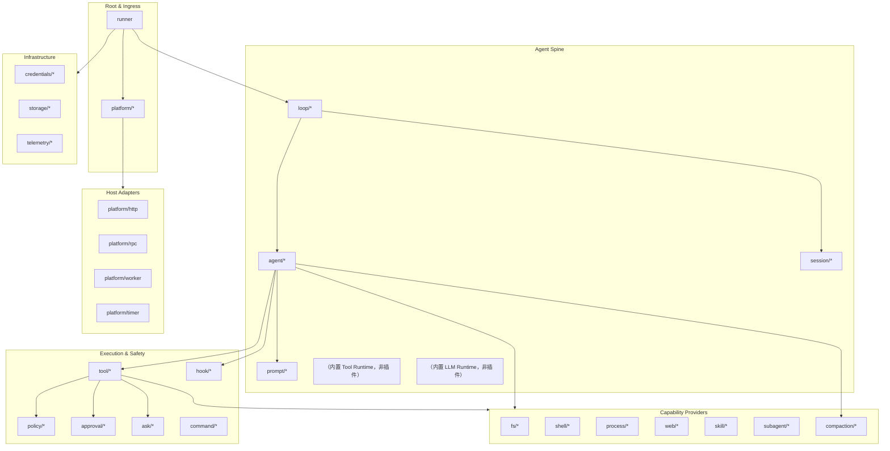

# AgentKit 插件目录

本文定义 AgentKit 的 **Plugin Kind** 命名规范、分类体系和分阶段落地范围。Kind 通过 `pluginkit.Register(kind, New)` 注册；配置中使用 `use: <kind>` 引用。

相关文档：[go-agent-harness-architecture.zh.md](go-agent-harness-architecture.zh.md)、[roadmap.zh.md](roadmap.zh.md)、[config-catalog.zh.md](config-catalog.zh.md)（逐插件配置字段参考，自动生成）。

配置相关的 CLI 工具：

| 命令 | 用途 |
|---|---|
| `agent config describe <kind>` | 查看插件的 config 字段、默认值与 deps 注入点 |
| `agent config scaffold <kind>` | 生成可填充的 YAML 配置骨架（含 SetDefaults 默认值） |
| `agent config validate` | 不构造实例，校验整张配置图（decode → SetDefaults → Validate） |
| `agent config dump` | 输出合并后的完整配置图 |

## 1. 命名规范

```
<role>/<name>[/<variant>]
```

| 规则 | 示例 | 说明 |
|---|---|---|
| 小写 + 连字符 | `tool/read-file` | 不用 camelCase |
| role 表示运行时角色 | `llm/openai` | 不是包路径 |
| variant 表示实现 | `workspace/tenant` | 可选 |
| 同一 kind 进程内唯一 | — | 重复 Register panic |

**返回值类型决定运行时角色和挂载槽位**。例如单工具插件返回 `agentkit.Tool`，`tool/fs-workspace` 返回 `agentkit.ToolPack`，`tool/mcp` 返回 `agentkit.ToolProvider`，`tools/runtime` 与 `tools/deferred` 返回 `agentkit.ToolRuntime`（后者包装内层 catalog，渐进披露 MCP/OpenAPI，见 [deferred-tools.zh.md](guides/deferred-tools.zh.md)）。

## 2. 插件分类总览



## 3. 插件 Kind 目录

### 3.1 Root & Platform

| Kind | 返回类型 | 职责 | 参考 |
|---|---|---|---|
| `runner` | `agentkit.Runner` | 进程 root，启动 Platform + Loop + `schedule.Runtime`，管理 StartStop；`sessionScope` 折叠 delivery SessionID（默认 channel）；`maxConcurrentTurns` 控制跨 session 并发（默认 64，同 session 内始终保序）；`config.inject` 在 dispatch 前 prepend `[meta ...]`（sender_id / timestamp / task_id 等，对齐 cc-connect）；per-turn panic 隔离，关停等待 in-flight turn | DSH Loader root / Pi AgentSession 外层 |
| `platform/cli` | `agentkit.Platform` + `permission.Capable` | 终端 stdin/stdout；稳定 delivery `cli:default`，经 `session/store` active-session 映射恢复 conversation；slash 走 `common.ProcessSlash`（含 `/new`、`/help`）；allow/deny 与 ask 经 Permission 协议读 stdin | Pi TUI / DSH headless |
| `platform/slack` | `agentkit.Platform` + `chathistory.Provider` | Slack Socket Mode；生成 cc-connect 风格 SessionID；Block Kit `perm:` / `cmd:` / 未知 `block_actions` forward（`unknownCardAction`）；供 `tool/chat-history` 读取频道/线程历史 | cc-connect `platform/slack` |
| `platform/feishu` | `agentkit.Platform` + `chathistory.Provider` | 飞书 WebSocket；生成 cc-connect 风格 SessionID；rich 单卡 Patch（thinking / tool / 正文同卡刷新）；`showThinking` / `showToolProgress`；卡片 `perm:` / `nav:` / `act:` / `cmd:` / 未知回调 forward（`unknownCardAction`）；自定义事件：`deps.eventHandlers` 注入 `cap/larkevent.Handler` 插件按事件类型订阅（同一类型可命中多个），`config.forwardEventsToAgent` 把事件序列化为 inbound 消息直转 agent（每条事件独立 session `<platform>:evt:<event_id>`；回复按事件上下文路由群/p2p，无上下文则无回复目标）；供 `tool/chat-history` 读取 IM 群/话题历史 | cc-connect `platform/feishu` |
| `platform/lark` | `agentkit.Platform` + `chathistory.Provider` | 国际版 Lark（`platform/feishu` 的 domain 预设）；流式卡片与自定义事件配置同 feishu | cc-connect `platform/feishu` |
| `platform/chat-api` | `agentkit.Platform` | HTTP + SSE 调试台；会话/消息 API（可选 `deps.sessionIndex` 与 `session-query` 共用 SQLite 索引列会话）；SSE 断线重连（`POST /chat-messages` + `run_id`）；`POST /runs/{id}/cancel`；文件上传下载；`registerOnly` 时只挂载 `http.DefaultServeMux`，由 `platform/http` 等插件监听 | `sessionIndex` |
| `platform/multiplex` | `agentkit.Platform` | 聚合多个 Platform（CLI + IM 等共存） | 多入口 fan-in / 按 PlatformID 精确回写（`PlatformID` 为空则拒绝，不广播） |
| `platform/http` | `agentkit.Platform` | 监听并服务 `http.DefaultServeMux`；与 `chat-api.registerOnly` 或其它 `http.Handle` 扩展组合 | DSH Web Host |
| `platform/acp` | `agentkit.Platform` + `permission.Capable` | stdio ACP Agent；供 Zed 等 ACP 客户端子进程接入；权限经 ACP `request_permission` 回传客户端 | — |
| `platform/rpc` | `agentkit.Platform` + `permission.Capable` | stdio Pi RPC（LF-JSON 命令进、Pi 事件出）；`Interactive=false`；`set_model` 在 session store 支持 runtime bind 时写入模型 | Centaur PiHarness |
| `platform/worker` | `agentkit.Platform` | headless 一次性任务 runner（从不读 stdin，`output` 支持 text / json）。task 为 `prompt`（agent turn）或 `script`（bash 脚本，需 `deps.workspace` + `deps.shell`）；日历 cron 用 `schedule/cron` | DSH headless |
| `platform/timer` | `agentkit.Platform` | 进程内定时器：按固定间隔自己发起 turn，tick 锚定启动时间、跳过错过的 boundary | — |

**IM 附件**：`platform/slack`、`platform/feishu`、`platform/lark`、`platform/chat-api` 的 `deps.workspace` 为必填。入站图片会先落到租户 `work/upload/`，session 存 `attachment_ref`（路径相对租户根，如 `work/upload/foo.png`），Agent 调用 LLM 前再从 workspace hydrate 为 vision；未挂 workspace 时图片会在落盘时被丢弃。

**HTTP 组合**：`chat-api` 默认自建监听（`listenAddr`，默认 `:8030`）。需要与其它 HTTP 路由共用同一端口时，设 `registerOnly: true`（或 `listenAddr: "-"`），由 `platform/http` 监听 `http.DefaultServeMux`；其它插件可在构建阶段 `http.Handle` 挂载自定义路由。

```yaml
platform.default:
  use: platform/multiplex
  deps:
    platforms: [platform.chat-api, platform.http]

platform.chat-api:
  use: platform/chat-api
  config:
    registerOnly: true
    path: /v1/

platform.http:
  use: platform/http
  config:
    listenAddr: ":8080"
```

### 3.2 Agent Spine

| Kind | 返回类型 | 职责 | 参考 |
|---|---|---|---|
| `loop/default` | `agentkit.Loop` + `agentkit.CommandProvider` | Turn/Step 调度、按 `TurnEnvelope.Conversation` 串行，并向 ctx 写入 `KeyTurnEnvelope` 等 context key；作为 agent 目录属主贡献 `/agent`、`/model` 命令（可选 deps `sessionStore`/`workspace`/`modelCatalog` 只服务命令，不影响分发） | DSH `agent-loop` / Pi `agentLoop` |
| `loop/harness` | `agentkit.Loop` | 多 Lane + 操作化 run/compaction/navigation（roadmap） | Pi AgentHarness |
| `agent/coding` | `agentkit.Agent` | Coding Agent；`config`：`id` / `model` / `retry` / `maxSteps`（默认 200，`0`=不限）/ `maxPromptTokens`（发送前兜底，`0`=关闭）；自主续跑靠 `deps.hooks`（如 `hook/turn-continue`） | 两者默认 Agent |
| `agent/acp-remote` | `agentkit.Agent` | 通过 ACP 调用外部 Agent（Claude Code、Cursor CLI 等） | DSH `dsh-acp` |
| `agent/chain` | `agentkit.Agent` | 顺序链：一次入站依次跑 `config.nodes` 引用的多个 Agent（deps `agents` 注入），共享同一 session；入站 user 消息只在首个节点落盘。跳过/重复执行策略由包装插件承载，chain 本身不做 | — |
| `agent/readonly` | `agentkit.Agent` | 只读审查 Agent（roadmap） | DSH permission preset |
| `session/memory` | `agentkit.Session` | 内存 Session（测试用） | — |
| `session/jsonl` | `agentkit.Session` | 单文件 JSONL 追加日志 | Pi JSONL v3 |
| `session/store` | `agentkit.SessionStore` | 按不透明 SessionID 懒加载 `{safe_id}.jsonl`；LRU 热缓存 + 内存 tail 窗口（`maxLoadedEvents`）；压缩后裁剪内存；完整历史 `Read(0)` 读盘 | cc-connect SessionKey |
| `session/sql` | `agentkit.SessionStore` | 会话事件与 runtime/active 映射写入 SQL（`driver`+`dsn`）；语义与 `session/store` 一致，不依赖 workspace 下 JSONL 文件 | 生产持久化 |
| `session/sqlite` | `agentkit.SessionStore` | `session/sql` 别名，`driver` 默认 `sqlite` | — |
| `session/postgres` | `agentkit.SessionStore` | `session/sql` 别名，`driver` 默认 `pgx` | — |
| `session/events` | `cap/session.Events`（组合 `Conversation` / `RunLog` / `Compaction` / `Skills`，另含恢复标记方法） | 会话事件追加/索引契约的标准实现（无状态）；插件经 `sessionEvents` 注入同一实例，deps 类型取最小面（todo/finish→`RunLog`，skill→`Skills`，compaction/summary→`Compaction`，acp-remote→`Conversation`）；runtime 经 `sessevents.Default` 单例追加契约事件 | — |
| `session/commands` | `agentkit.CommandProvider` | `/new`、`/session` 会话生命周期 slash；deps 注入 `sessionStore` | — |
| `session/sqlite-index` | `cap/sessionindex.Service` | 租户内 session JSONL 的 SQLite FTS5 索引（`sessions/.index.sqlite`）；`Sync(ctx)` 自行按 `sessionsRel`（默认 `sessions`）解析会话目录 | DSH session-query-sqlite |
| `session/sql-index` | `cap/sessionindex.Service` | 从 `session/sql` 主库（`ak_session_events`）增量派生 FTS（水位表 `ak_session_index_state`，含 `max_created_at_ns` 供按最近活跃排序）；索引与会话同库同 DSN，Docker 只需持久化一处；查询默认按 ctx workspace（channel）过滤，`rctx.WithSessionIndexGlobal` 可显式放开全局；SQLite 用 FTS5，PG 用普通表 + `LIKE`（`tsvector` 留作后续） | — |
| `hook/session-index` | `agentkit.HookProvider` | 每轮成功后异步刷新 session FTS | — |
| `tool/session-query` | `agentkit.Tool` | `session_search`：`mode=search`（FTS）、`list`（按最近活跃排序，当前会话标 `Current` 并置顶）、`scroll`；默认限定当前 channel（workspace），`scope=global` 显式查全局（仅 sql-index 等共享库后端生效） | DSH session-query |
| `tool/memory` | `agentkit.Tool` | 主 agent `memory`：`add` / `replace` / `remove`（`memory.md`）；Hermes 式 WHEN/HOW/SKIP 说明（`MemoryToolDescription`） | memory.default |
| `prompt/assembler/default` | `agentkit.PromptAssembler` | Section 排序与组装 | DSH `system-prompt` |
| `prompt/section/agents-md` | `agentkit.SectionProvider` | AGENTS.md 层级加载（deps `fs` 接 unrestricted 实例；向上遍历传宿主机绝对路径，非本地后端静默 miss）；`prompt/section/file` 的预设别名 | DSH `agent-instructions` / Pi AGENTS.md |
| `prompt/section/file` | `agentkit.SectionProvider` | 通用文件内容注入：按 `filenames` 读 workspace 文件拼进 prompt，`walkUp` 可向上遍历；适用于 AGENTS.md 之外的任意指令/约定文件 | — |
| `prompt/section/static` | `agentkit.SectionProvider` | 配置内联自定义 system prompt 文本 | — |
| `prompt/section/skills` | `agentkit.SectionProvider` | Skill catalog 注入 | DSH/Pi Skills |
| `prompt/section/memory` | `agentkit.SectionProvider` | `global:memory.md` + 租户 local `memory.md`（无目录递归）；同 turn 冻结快照 | — |
| `prompt/section/subagents` | `agentkit.SectionProvider` | 可委派子 Agent 名单注入；定义在磁盘上会变，所以走每轮重建的 section 而不是 `delegate` 的静态 description。可选 `deps.llm`：主模型为 text-only 且存在**显式**声明 `modalities` 含 image 的子 Agent 时，追加委派看图提示 | — |
| `prompt/section/workspace-dirs` | `agentkit.SectionProvider` | 把配置的 scoped 目录（`local:`/`global:`）解析成本会话绝对路径注入 prompt，并附优先级/生效规则 note；每轮按请求 ctx 解析，`workspace/tenant` 下各租户 local 根各自正确 | — |
| `prompt/section/time` | `agentkit.SectionProvider` | 当前时间上下文（roadmap） | DSH `time-context` |
| `llm/router` | `agentkit.LLMProvider` | 按 `config.models[].id` 将 `LLMRequest.Model` 路由到 `deps.protocols` 中某一协议实例；未命中走 `deps.default`。Agent 只选模型名。设计 [plans/2026-09-23-llm-protocol-router-design.md](plans/2026-09-23-llm-protocol-router-design.md) | Pi `Models` 分发 / Hermes `api_mode` |
| `llm/openai-chat` | `agentkit.LLMProvider` | OpenAI Chat Completions；`config.models[]` 供 router catalog | Pi openai-completions |
| `llm/openai-responses` | `agentkit.LLMProvider` | OpenAI Responses API；`hostedTools`；`config.models[]` 供 router catalog | Pi openai-responses |
| `llm/openai-compatible` | `agentkit.LLMProvider` | OpenAI 兼容 API；`api: responses` 时可配 `hostedTools`（如 `web_search`，服务端执行）。单协议简易配置；多协议推荐 router + chat/responses 实例 | Pi openai-responses |
| `llm/fallback` | `agentkit.LLMProvider` | 主模型/主 provider 失败时按序切换备用 model 或 provider；同 endpoint 只需一份底层 provider | — |
| `llm/anthropic` | `agentkit.LLMProvider` | Anthropic Messages API（roadmap）；`config.models[]` 供 router catalog | Pi anthropic-messages |
| `llm/deepseek` | `agentkit.LLMProvider` | DeepSeek API（roadmap） | DSH llm-deepseek |
| `llm/replay` | `agentkit.LLMProvider` | 录制回放（测试，roadmap） | DSH llm-replay |

**`llm/openai-compatible`**：`config.modalities` 声明输入能力（`text` / `image` / `audio`，默认可看图）；纯文本模型设 `[text]`，运行时会把附件降为 `[attachment: …]` 文本。`api` 为 `responses`（L0 默认）或 `chat`；`hostedTools` 仅在 `responses` 下生效，用于 OpenAI 内置工具（如 `web_search`），由 provider 服务端执行，不走 agentkit 工具循环。`api: chat` 且请求带 function tools 时，若未配置 `reasoning.effort`，运行时会显式发送 `reasoning_effort: none`，以兼容部分网关对 reasoning 模型在 `/v1/chat/completions` 上的默认 effort；需要 reasoning + tools 时请改用 `api: responses` 或在 chat 下自行设 `reasoning.effort`（非 `none` 时网关可能仍拒绝 tools）。L0 已默认启用 `hostedTools.web_search`，`tools.default` 不再挂 `tool/web-search-*`。若改回 Tavily/DuckDuckGo 等本地搜索插件，需同时设 `api: chat` 并自行把 `tool/web-search-*` 加回 `tools`。超时分两档：`responseHeaderTimeoutSeconds` 限制 **连接 + TLS + HTTP 响应头**（默认 60，对应 `net/http` `ResponseHeaderTimeout`）；`timeoutSeconds` 限制 **首 token / TTFB**（默认 180，应用层 `streamWithRequestTimeout`，流式常先返回 200 再等模型）。后续流式 token 不受 `timeoutSeconds` 限制。与 agent turn 步数、工具 `timeoutSeconds` 独立（agent runtime 默认不限步）。示例：

```yaml
llm.default:
  config:
    api: responses
    hostedTools:
      - type: web_search
        parameters:
          search_context_size: medium
```


**`llm/router`**：`deps.protocols` 列出协议插件实例；`deps.default` 为兜底实例（可不填 `models`，不参与精确匹配）。各协议在 `config.models[].id` 注册模型 id，**全局不可重复**。Agent `deps.llm` 指向 router 时仅配置 `config.model`；`/model` 只改模型名，下一 step 自动换协议。示例见设计 doc。

**`llm/fallback`**：装饰器插件，包装一个或多个底层 `LLMProvider`。推荐 `deps.llm: llm/router`，在 fallback 里列 `fallbackModels`；主 model 来自 agent 的 `config.model`，协议由 router 按模型 id 选择。跨 provider 时在 `deps.fallbacks` 列出多个实例并配 `config.models`。`fallbackOn` 默认 `retryable`（复用 `llm.IsRetryableError`；**首 token 超时** `context.DeadlineExceeded` 在尚未输出任何内容时也会切下一候选）。网关返回 `Model '<id>' is not available in this group`（常见 HTTP 404）在 `retryable` / `quota` / `any` 下都会切下一候选，且**不会**对同一模型做 provider retry。`context.Canceled` 不触发 fallback。也可设 `quota` 或 `any`。包装 router 时 **`ModalitiesForModel` 随当前 attempt 的 model 变化**（与 LLM 调用前 `PrepareMessagesForLLM` 一致）。每次切换到下一候选时通过 telemetry 记录 **`llm.fallback` 事件**（`phase`、`from_*` / `to_*`、`reason`、`fallback_on`），便于 Langfuse trace 排查。同时以 `agentkit.CommandProvider` 贡献只读 slash **`/fallback`**（展示 `fallbackOn`、配置模型与 attempt 链），由 `commands/registry` 统一收集。

```yaml
llm.default:
  use: llm/openai-compatible
  config:
    baseUrl: https://api.openai.com/v1
    apiKeyRef: env:OPENAI_API_KEY

llm.fallback:
  use: llm/fallback
  config:
    fallbackModels:
      - gpt-4o
      - gpt-4o-mini
  deps:
    provider: llm.default
```

**`agent/acp-remote`**：通过 stdio ACP 调用外部 Agent 子进程（如 Cursor CLI `agent acp`、Claude Agent SDK 等）。环境准备（安装依赖、授权登录）由用户自行处理，acp-remote 只负责连接与失败提示。

- **模型查询**：通过 `/acp-<id> model show` 或 `show` 查看远端报告的当前模型；正常对话和配置更新不额外发送模型 thinking 提示。
- **模型与通用配置命令**：每个实例直接按已有 `config.id` 提供 `/acp-<id>`，例如 `id: claude` 对应 `/acp-claude`，无需额外命令名配置；同名命令由注册器检查冲突（忽略大小写）。裸命令仅展示简洁的子命令导航，不连接远端；`mode`、`model`、`effort` 展示对应配置的当前值、初始观察值、可选值和修改示例，也可通过 `<value>` 修改。修改成功仅回显对应项；子命令后紧跟 `-g`（或 `--global`）查询/设置 AgentKit 持久化的全局默认值，仅影响之后新建的会话，不改动已有或恢复的会话，也不写厂商 CLI 配置。全局查询无需连接远端，设置会在独立配置会话验证通过后保存；`config show`（兼容 `show`）可显式查看全部配置。`config` 支持远端暴露的全部 select/boolean 配置，包含 model、effort、fast-mode 等；会话修改通过当前会话的 ACP `session/set_config_option`，并以响应的全量状态和远端主动通知为准。远端未暴露的能力会明确提示不可用，不自动修改 CLI 全局配置。

```text
/acp-claude                            # 子命令导航，不连接远端
/acp-claude mode                       # 展示模式选项
/acp-claude effort high                # 修改 effort，仅展示该项
/acp-claude model show                 # 展示模型选项
/acp-claude model opus                 # 切换当前会话模型（以远端实际可选值为准）
/acp-claude model -g                   # 查看全局默认模型
/acp-claude model -g opus              # 保存全局默认模型
/acp-claude model reset                # 恢复当前连接首次观察到的模型值
/acp-claude model -g reset             # 清除全局默认模型，不连接远端
/acp-claude config -g reset            # 清除全部全局默认值，不连接远端
/acp-claude config -g old-option reset # 清除单个已过时的全局配置项
/acp-claude mode -g plan               # 保存全局默认模式
/acp-claude effort -g high             # 保存全局默认 effort
/acp-claude config -g fast-mode true   # 保存通用配置的全局默认值
/acp-claude config -g show             # 查看已保存的全部全局默认值
/acp-claude config show                # 展示全部配置
/acp-claude config show effort         # 展示指定配置的当前值、初始值、可选值
/acp-claude config effort high         # 设置远端配置项
/acp-codex config fast-mode true       # 布尔配置，支持 true / false
/acp-cursor                            # 显示子命令导航，不连接远端
```

`show` 可能启动远端进程并新建/恢复会话，但不发送 prompt；历史重放延迟到下一次正常对话。ACP 配置项没有默认值字段，因此输出明确显示 `default: (not provided)`；`initial` 是本次连接首次观察到的值，恢复会话或重连后不能当作厂商/全局默认值。远端不提供 configOptions（例如部分 Cursor ACP 版本）时无法通过协议查询/修改；需自行显式配置启动参数。`reset` 是显式重置操作：session 级恢复当前连接首次观察到的值（不是厂商默认值），global 级删除保存的默认值；`default` 仍作为普通远端选项值。配置命令默认操作超时 5 秒（含锁等待），较短的调用方超时优先；超时后仍会完成必要的子进程清理。全局查询不等待远端校验，配置校验进程每次操作后释放，以重新绑定下次请求的工作目录和沙箱。

要点：

- **工作目录**：`config.cwd`（未设则默认 `work/`，与 `tool/shell-bash` 一致）同时作为 ACP 子进程的 `cmd.Dir` 与 `session/new` 的 `Cwd`。代码仓库在 `work/agent-harness` 等子目录时设 `cwd: work/agent-harness`（或 `local:work/agent-harness`）。bind 文件会记录 cwd；变更 cwd 后会新建 ACP session 而非 resume 旧 cwd。
- **认证失败提示**：连接认证、会话创建或请求执行返回 ACP `Authentication required`（-32000）时，统一返回可读的排查指引，并附带 **错误详情**（含阶段如 `session/new`、`session/prompt` 与脱敏后的 JSON-RPC `code`/`message`/`data`）；`config.authHint` 可覆盖具体操作步骤，未配置也有通用指引。错误仍支持 `errors.Is/As` 追溯原始原因，不再额外发送一条重复的 assistant 提示。会提示同一用户的 CLI 登录、shell 启动文件读权限、变量 `export` 与后台服务重启，并仅显示相关凭据变量在实例覆盖后的“已设置/未设置”，不输出变量值；协议 `data` 中疑似密钥字段会替换为 `[redacted]`。同失败会写 `acp-remote: authentication required` / `acp-remote: <stage> failed` 结构化日志（`stage`、`detail`、`acp_code`）。普通网络错误、取消和超时保持原有含义。`config.authMethod` 非空时仍调用 ACP `Authenticate`。
- **子进程清理**：L0 对 `agent.cursor` / `agent.claude` / `agent.codex` 启用 `releaseSubprocessAfterTurn: true`——每个 RunTurn 结束后按进程组 SIGTERM/SIGKILL 回收 `agent acp` 及其子进程（language server、worker-server 等），避免多次委派后内存上涨。Unix 上使用进程组；子进程异常退出时会取消进行中的 `Prompt`，让 async 委派尽快失败并触发 `subagent/end` + follow-up，而不是挂到 `timeoutSeconds`。
- **API Key 路径**（可选）：`agent -p` 用 `CURSOR_API_KEY`；ACP 用 `CURSOR_AUTH_TOKEN`（`--auth-token`），与 `cursor_login` 互斥。
- **会话续聊（Docker 重启）**：`NewSession` 成功后把 ACP `sessionId` 经 deps `fs` 写入 `acp/<session>/acp-session.<agentId>.json`（插件自有目录，与 session 存储后端无关；多个 `acp-remote` 按 agent id 分文件）。有 bind 时经 deps `sessionRestore`（`acp/session-restore`）尝试 `session/resume` 或 `session/load`（见 `strategy`）；失败则 `NewSession` 并从 `sessionStore` 重放 harness 历史。未注入 `sessionRestore` 时仅尝试 `session/resume`（兼容旧配置）。**Cursor CLI**（[官方 ACP 文档](https://cursor.com/cn/docs/cli/acp)）不实现 `session/resume`，但 `session/load` 可恢复**已 prompt 过**的会话（`session/new` 返回的 id 在首次 prompt 后由 Cursor 持久化，子进程重启后 load 同 id 即恢复上下文）；L0 `agent.cursor` 使用 `strategy: cursor`（= load）。`session/new` 后尚未 prompt 的会话不会被持久化，load 报 not found 属预期，回退 `NewSession` 无损失（本就无历史）。Claude 侧 transcript 在 `~/.claude/projects/`，容器内需挂载该目录与 `sessions/` 工作区。
- **Harness MCP（可选）**：不把 `mcp.json` 再传给远端（Claude/Cursor 自行加载项目 MCP）。若需按当前 turn 的会话上下文向远端注入额外 MCP，在 deps 注入 `cap/acp.SessionMCPProvider`（配置键 `sessionMcp`）。`session/new` 与 restore 方法均携带当时解析出的最新 `mcpServers`。后续可用此扩展把 Loop 内 tools 虚拟成 MCP（如 ACP transport）。
- **出站工具结果**：ACP `ToolCallUpdate` 在 `completed` / `failed` 时除 `toolcall_end` 外还会发 harness `tool/result`（输出取自 `rawOutput` / `content`），供飞书过程卡与 `forwardParentEmit` 转发的 async 子 Agent 进度展示；不写入 harness session 事件流（与 Loop 内 `tool.Execute` 路径不同）。
- **Langfuse**：每个 ACP `Prompt` 对应一条 `acp.generation` observation（input 为本 turn 用户消息；output 含 `AgentThoughtChunk` 与最终回复）；ACP 上报的 `ToolCall` 导出为嵌套 span。Cursor 在进程内执行且未通过 ACP 推送的工具调用不会出现在 Langfuse；token/model 以远端 Agent 为准，harness 不补全。

```yaml
agent.cursor.default:
  use: agent/acp-remote
  config:
    id: cursor
    command: [agent, --trust, acp]
    cwd: work
    releaseSubprocessAfterTurn: true
    authMethod: cursor_login
    authHint: "ACP 认证失败。请执行 /sh agent login 完成授权后重试。"
    env:
      NO_OPEN_BROWSER: "1"
    autoApprove: false
  deps:
    workspace: workspace.default
    sessionStore: sessionStore.default
    sessionRestore: acp.sessionRestore.cursor
```

通过 `/agent use cursor` 或 chat-api `agent_id=cursor` 切换到此 Agent。

**`acp/session-restore`**：为 `agent/acp-remote` 提供 `cap/acp.SessionRestorer`。`config.strategy`：`resume` | `load` | `auto`（按 initialize 能力先 resume 再 load）| `skip` | `cursor`（等同 load，面向 Cursor CLI——其不支持 `session/resume`，但 `session/load` 可跨进程恢复已 prompt 的会话）。

**Claude Agent SDK（`claude-agent-acp`）**：通过 `npx @agentclientprotocol/claude-agent-acp` 启动 ACP 子进程；不设 `authMethod`，凭证由 env 注入子进程（需 Node.js ≥ 22）：

```yaml
agent.claude.default:
  use: agent/acp-remote
  config:
    id: claude
    command: [npx, -y, "@agentclientprotocol/claude-agent-acp"]
    env:
      ANTHROPIC_API_KEY: ${var:ANTHROPIC_API_KEY}
      ANTHROPIC_BASE_URL: ${var:ANTHROPIC_BASE_URL:-https://api.anthropic.com}
    autoApprove: false
  deps:
    workspace: workspace.default
    sessionStore: sessionStore.default
```

- **API Key**：`OPENAI_API_KEY` 等（`/env add` 写入 `global:secrets.enc.json`，或 export；需 L1 配置 `credentials.*.config.secretsKey`）
- **自定义网关 / 代理**：`ANTHROPIC_BASE_URL` 指向兼容 Anthropic Messages API 的 base URL
- 通过 `/agent use claude` 或 chat-api `agent_id=claude` 切换；主 agent 也可 `delegate` 到 `claude`

**Codex CLI（`codex-acp`）**：Codex CLI 没有官方内置 ACP（[openai/codex#30052](https://github.com/openai/codex/issues/30052) 仍 open），通过 `npx @agentclientprotocol/codex-acp` 启动 ACP 子进程（agentclientprotocol 组织维护的适配器，包内自带兼容版本的 `@openai/codex` 依赖，可用 `CODEX_PATH` 指定其他 codex 二进制）。适配器在 initialize 时声明 ACP auth methods：ChatGPT 登录（远程环境设 `NO_BROWSER=1` 隐藏）或 API key（`CODEX_API_KEY` 优先于 `OPENAI_API_KEY`）；L0 不设 `authMethod`，凭证由 env 注入，用户也可自行 `codex login`（写 `~/.codex/auth.json`）：

```yaml
agent.codex.default:
  use: agent/acp-remote
  config:
    id: codex
    command: [npx, -y, "@agentclientprotocol/codex-acp"]
    cwd: work
    releaseSubprocessAfterTurn: true
    authHint: "Codex ACP 连接失败。请确认已安装 codex CLI 并执行 /sh codex login 完成授权后重试（或配置 CODEX_API_KEY / OPENAI_API_KEY）。"
    env:
      CODEX_API_KEY: ${var:CODEX_API_KEY:-}
      OPENAI_API_KEY: ${var:OPENAI_API_KEY:-}
    autoApprove: false
  deps:
    workspace: workspace.default
    sessionStore: sessionStore.default
```

- 通过 `/agent use codex` 或 chat-api `agent_id=codex` 切换；主 agent 也可 `delegate` 到 `codex`


**原生命令**：ACP 子进程的原生斜杠命令（如 `/fast`）与 AgentKit slash 是两套东西——在与该 agent 对话时直接输入即可（ACP 规范里经 `session/prompt` 发送，与直接对话等价）。`session/set_config_option` 控制面当前不暴露，远端 agent 的 model/mode 在启动配置里确定。

### 3.3 Tool 插件（模型可见工具）

Tool 插件按工具来源返回不同类型：单工具插件返回 `agentkit.Tool`，多工具插件返回 `agentkit.ToolPack`，动态工具插件返回 `agentkit.ToolProvider`。它们经 `tools/runtime` 或 `tools/deferred`（deps 槽位相同）的 `deps.tools`、`deps.toolPacks`、`deps.dynamicTools` 聚合后暴露给模型。

| Kind | 依赖 | 职责 |
|---|---|---|
| `tools/deferred` | 与 `tools/runtime` 相同（`hooks`、`tools`、`toolPacks`、`dynamicTools`、`policies`、`approval`） | 内部构造 runtime；`enabled: true` 时将动态工具换为 `tool_search` / `tool_list` / `tool_describe` / `tool_call`，unwrap 后走同一执行平面 |

| Kind | 依赖 | 模型工具名 | 职责 |
|---|---|---|---|
| `tool/fs-workspace` | `fs`（`filesystem.Service`）、`workspace?` | `read` / `write` / `edit` / `grep` / `find` / `ls` | 工作区文件工具组；`config.readOnly` / `config.tools` 可限制能力。路径根与 gitignore 在 `deps.fs`（默认 `filesystem/local`） |
| `tool/fs-memory` | — | 同上 | 内存 `filesystem.Service`，测试与冒烟 |
| `tool/shell-bash` | `workspace`, `credentials`（L0 默认 `integrations`） | `bash` | Shell（pi 对齐：`command` + 可选 `timeout`；合并 stdout/stderr；非零退出/超时为 tool 错误文本）；L1 `scopedEnv` 或 `/env add` 注入 gh/npm 等 token，见 [guides/credentials.zh.md](guides/credentials.zh.md) |
| `tool/web-search-auto` | `credentials?` | `web_search` | 可选：Tavily 优先，缺 key/失败时 fallback DuckDuckGo |
| `tool/web-search-tavily` | `credentials?` | `web_search` | Tavily 搜索 |
| `tool/web-search-duckduckgo` | — | `web_search` | DuckDuckGo HTML 抓取，无需 key |
| `tool/web-search-exa` | `credentials?` | `web_search` | Exa 搜索（可选替代） |
| `tool/web-fetch-http` | — | `web_fetch` | HTTP 抓取；私网地址在 dial 时拦截 |
| `tool/web-search-scripted` | — | `web_search` | 预置命中，测试与冒烟 |
| `tool/web-fetch-scripted` | — | `web_fetch` | 预置页面，测试与冒烟 |
| `tool/skill` | `skills`, `sessionStore` | `skill` | 按名加载 `SKILL.md` 并注入会话；附属文件用 `read`，脚本用 `bash` |
| `tool/subagent` | `subagent` | `delegate` | 子 Agent 委派 |
| `tool/workflow` | `runtime`, `workspace`（可选 `llm`、`subagent`、`telemetry`、`shell`） | `workflow__<name>`（每 workflow 文件一个动态工具，挂 `deps.dynamicTools`） | 把 workflows 目录里的声明式管线（script/tool/model/agent step，默认串行，支持 `dependsOn` DAG 并行与 `when` 条件）各暴露为一个工具，`inputs` 即工具 InputSchema，中间数据 by reference 不过主模型；`deps.runtime` 必须是不含 `tool/workflow` 自身的兄弟实例。详见 [guides/workflow.zh.md](guides/workflow.zh.md) |
| `tool/ask-user` | — | `ask_user` | 向用户提问（HIL） |
| `tool/todo` | `sessionStore` | `todo` | durable 任务清单 |
| `tool/finish` | `sessionStore` | `finish` | 显式收尾 |
| `tool/set-model` | `sessionStore` | `set_model` | Agent 自主切换本会话模型（写与 `/model` 相同的 `runtime.json` 覆盖，下一 turn 生效）；`config.allowModels` 白名单；子 Agent 上下文拒绝调用 |
| `tool/schedule` | `schedule` | `schedule` | agent 自主排期 |
| `tool/send` | `sender`, `workspace?`, `fs?` | `send` | 经 delivery.Sender 主动发送文本或工作区文件；`/send [-r\|--raw] <chatId> <message>` 管理面投递（同平台裸 chat/channel id，消息可多行；`-r` 跳过平台 Markdown 转换）；L0 `tools.default` 已启用 |
| `tool/chat-history` | `history`（`agentkit.Platform`，运行时适配为 `chathistory.Router`） | `chat_history` | 读取 IM 传输层群/会话历史；平台未实现 Provider 时返回空；`thread` 默认 true——限定当前回复链/话题（feishu 侧含转话题前的群内回复，链与话题两部分合并）；false 读整个群；L0 `tools.default` 已启用 |
| `tool/recognize` | `llm`, `workspace` | `recognize_image` | 对 `work/` 下图片做视觉理解并返回文本；`config.model` 指定视觉模型（可与主 Agent 模型不同）。L0 `tools.default` 已启用 |
| `tool/mcp` | `fs`, `credentials?` | *(动态)* | 读取 `mcpServers` JSON 并暴露 MCP 工具；维护指南见 Skill `mcp-manager`（`skills/mcp-manager/SKILL.md`）。详见 [guides/tools.zh.md](guides/tools.zh.md)。 |
| `tool/openapi` | `fs`, `credentials?` | *(动态)* | 读取 `api.json` 索引并暴露 HTTP 工具；维护指南见 Skill `openapi-manager`；`/openapi -u` 重载。详见 [guides/tools.zh.md](guides/tools.zh.md)。 |

**`filesystem/local` 插件 config**（kind 在 `runtime/filesystem`）：

| 字段 | 默认 | 说明 |
|---|---|---|
| `root` | `.` | 相对 workspace 根的读写根 |
| `unrestricted` | `false` | 为 `true` 时关闭路径权限控制，不将路径限制在 `root` 内（含 `../`、绝对路径等） |

L0 `config.base.yaml` 有两个实例：`filesystem.local.default`（`root: work`、`unrestricted: true`，fs 工具与 agents-md/send 的绝对路径读取）与 `filesystem.local.state`（`root: "."`，memory/learning/skills/schedule/credentials/mcp/openapi/acp-remote 的状态与配置文件）。`global:`/`local:` 前缀一律委托 workspace 双根路由，不受 `root` 限制。

**`tool/fs-workspace` 插件 config**（另有 `maxBytes` / `maxMatches` / `maxResults` / `maxListEntries` 上限）：

| 字段 | 默认 | 说明 |
|---|---|---|
| `readOnly` | `false` | 拒绝 `write` / `edit` |
| `tools` | 全部 | 限制注册的模型工具子集 |

`root` / `unrestricted` 若仍写在 tool 上会被忽略，请配在 `filesystem/local`。换对象存储或远程盘：实现 `cap/filesystem.Service` 并注册 `filesystem/<name>`，将 `deps.fs` 指向该实例。

**`tool/fs-workspace` 模型参数**：

| 工具 | 关键参数 | 行为要点 |
|---|---|---|
| `read` | `path`, `offset`, `limit` | `path` 相对 fs `root` 或绝对路径（不解析 `local:`/`global:`）；返回带行号的纯文本；大文件截断并在末尾附续读 hint |
| `write` | `path`, `content` | 同 `read` 的 `path` 规则 |
| `edit` | `edits[]` | 每条 `oldText` 均对**原文**匹配后再一次性应用；返回 `Edited path` / `No changes applied` |
| `grep` | `pattern`, `path`, `limit`, `literal`, `context` | 返回 `path:line:` 纯文本；无匹配时 `No matches found` |
| `find` | `pattern`, `path`, `limit` | 返回路径列表纯文本；无结果时 `No files found` |
| `ls` | `path`, `limit` | 返回目录条目纯文本；目录以 `/` 结尾 |

### 3.4 Policy & Safety

| Kind | 返回类型 | 职责 | 参考 |
|---|---|---|---|
| `policy/deny-dangerous-shell` | `agentkit.Policy` | 拦截危险 shell 命令 | 两者常见 Extension |
| `policy/path-denylist` | `agentkit.Policy` | 路径黑名单（glob，默认拒 `.git/**`、`**/.env*`、`**/.ssh/**`、`**/*.pem`） | Pi path protection 示例 |
| `policy/shell-allowlist` | `agentkit.Policy` | shell 命令前缀白名单；`strict` 时白名单外一律 deny，链式命令每段都要命中 | — |
| `policy/network-deny` | `agentkit.Policy` | 禁止网络类工具（未做；`web/http-fetch` 自带的 scheme / host / 私网约束是它的雏形） | DSH sandbox policy |
| `policy/plan-mode` | `agentkit.Policy` | Plan 模式下限制写操作（roadmap） | DSH plan-mode |
| `approval/auto-deny` | `agentkit.Approval` | 自动拒绝 ask | 测试 / CI |
| `approval/auto-allow` | `agentkit.Approval` | 自动允许 ask（无人值守）；**不做任何过滤**，必须与 `policy/shell-allowlist` + `policy/path-denylist` 同时挂载 | 开发模式 |

> **说明**：交互式终端审批走 platform `permission.Capable`（见 [guides/platform-interaction.zh.md](guides/platform-interaction.zh.md)）。

### 3.5 Hooks（观察与改写，非裁决）

| Kind | 返回类型 | Hook 点 | 参考 |
|---|---|---|---|
| `hook/before-step` | `agentkit.HookProvider` | Turn 开始前注入/检查 | DSH `agent/pre-step` |
| `hook/turn-continue` | `agentkit.HookProvider` | Turn 末裁决续跑/收尾（`TurnStopping` seam）；`maxContinuations`（0=不续跑）、`stallLimit`、`requireFinish`、`requireTodosDone`、`continuePrompt`；贡献 `/status` | DSH `agent/turn-stopping` |
| `hook/session-index` | `agentkit.HookProvider` | 每轮成功后异步刷新 session FTS | — |
| `hook/turn-nudge` | `agentkit.HookProvider` | 两档预算提醒：每 `stepInterval` 个模型步 / 每 `timeIntervalMinutes` 分钟在工具结果末尾追加预算数值（`message`，仅告知不含指令）；达到 `stepLimit` / `timeLimitMinutes` 后每次工具结果都改发 `limitMessage`（要求立即总结并结束 turn）。步数与 `maxSteps` 同口径（一步可并行多个工具调用，批次内只注入一次）。只提醒不裁决，硬顶仍由 `maxSteps` / `hook/turn-continue` 承担 | — |
| `hook/background-review` | `agentkit.HookProvider` | Turn 成功后后台 LLM review（`TurnComplete`）；内建 `learn_capture`；deps `learning`（`ReviewHost` + `SkillProposer`）、`memory`（`Capture`）、`llm` | [guides/learning-dreaming.zh.md](guides/learning-dreaming.zh.md) §9 |

**已就绪的 hook 点接口**（`agentkit.HookRuntime` 支持，任何 `HookProvider` 插件均可贡献，尚无独立 kind）：

| Hook 点 | 接口 | 说明 |
|---|---|---|
| BeforeStep | `OnBeforeStep` | model step 前注入/检查；payload 带 `Step`/`Segment`（turn 内 0 起） |
| BeforeTool | `OnBeforeTool` | 工具 input 改写（policy allow 之后） |
| AfterTool | `OnAfterTool` | 工具 result 截断/改写 |
| TurnStopping | `OnTurnStopping` | Turn 末续跑/收尾裁决 |
| TurnComplete | `OnTurnComplete` | Turn 成功后后台任务（FTS 刷新、review fork 等）；payload 带 `Steps`/`Segments`/`TurnTokens` |

### 3.6 共享运行时插件

以下插件仍独立存在，供多个 tool / runtime 复用：

#### Skills & Subagent

| Kind | 返回类型 | 说明 |
|---|---|---|
| `skill/filesystem` | `skill.Registry` | 目录扫描 SKILL.md（deps `fs` + `workspace`；dirs 配置可用 `global:`/`local:`，对模型暴露绝对路径） |
| `skill/badge` | `skill.Registry` | Badge 元数据（roadmap） |
| `memory/default` | `CommandProvider` + `cap/memory.Service` | 租户 `memory.md`、ledger、staged、`/memory` 命令；`tool/memory` 与 prompt 注入；存储走 deps `fs` |
| `learning/default` | `CommandProvider` | Grounded Dreaming、Skill Workshop；`/learn` 巩固与技能（记忆见 `/memory`）；sidecar（dreaming state/diary/report、review nudge/quota、skills policy、workshop proposals）走 deps `fs` |
| `learning/dream-sweep` | `schedule.Runtime` | 后台三阶段 dreaming sweep（默认每天 03:00） |
| `subagent/inprocess` | `subagent.Spawner` + `subagent.SubmitBinder` + `agentkit.CommandProvider` | 进程内子 Agent：定义来自 `dirs` 下的 `agents/*.md`（frontmatter + 正文即 system prompt），串行 `Run` 一个子 agent 并只把结论带回；frontmatter `async: true`（或工具参数覆盖）时异步委派：立即返回 `status=running`，完成后经 runner 投递 `[subagent-complete]` follow-up turn。`deps.tools` 必须是**不含 `tool/subagent`** 的兄弟实例（既避开依赖环，也让"子 agent 不能再委派"成为结构性事实）。贡献 `/subagent`、`/submodel` 命令。详见 [guides/subagent.zh.md](guides/subagent.zh.md) |
| `subagent/loop-agent` | `subagent.Spawner` + `subagent.SubmitBinder` | 委派到 Loop 里已注册的 agent（如 `agent/acp-remote` 的 `cursor`）。可委派名单来自实例 `config.agents`；支持 `async: true`：立即返回 `status=running`，完成后经 runner 向父 session 投递 follow-up turn。deps 可注入 `telemetry`（通常 `telemetry.default`），为每次子 agent 运行导出独立 Langfuse trace |
| `subagent/composite` | `subagent.Spawner` + `subagent.SubmitBinder` | 合并 `inprocess` 与 `loop-agent` 的可委派名单；L0 `subagent.default` 使用此 kind |
| `subagent/rpc` | `subagent.Spawner` | RPC 子 Agent（roadmap） |

#### Schedule

| Kind | 返回类型 | 说明 |
|---|---|---|
| `schedule/file` | `schedule.Registry` | JSON 文件持久化的 cron job 表（deps `fs`）；原子写由 `filesystem.Service.Write` 保证，无进程内互斥锁，并发靠读完整快照 + 原子写 |
| `schedule/cron` | `schedule.Runtime` | 常驻日历调度：轮询 registry、到期后 submit inbound turn；由 runner 启动，与 `tool/schedule` 共用 registry |

#### Compaction & Context

| Kind | 返回类型 | 说明 |
|---|---|---|
| `compaction/summary` | `compaction.Service` | LLM 摘要压缩；`config`：`keepRecentTokens` / `reserveTokens` / `maxInputTokens`（摘要输入上限，默认 400k）/ `summaryModel` / `retry` |
| `compaction/prune-tool-results` | `compaction.Service` | 无模型工具结果裁剪 |
| `compaction/token-limit` | `compaction.Service` | 按 token 阈值门控内层压缩链（deps.services）；阈值取 `maxTokens` 或 `contextWindow × triggerRatio` |
| `compaction/pipeline` | `compaction.Service` | 按序执行 deps.services 中的压缩链，供 agent / hook 单点引用 |

### 3.7 Infrastructure

| Kind | 返回类型 | 说明 |
|---|---|---|
| `workspace/default` | `workspace.Service` | 双根工作区：`global`（默认 `~/.agentkit`）+ `local`（默认 `.agentkit`）；`scope` 选默认根；路径可用 `global:rel` / `local:rel` 前缀 |
| `workspace/tenant` | `workspace.Service` | 多租户工作区：`global` 全租户共享，`local` 根按 `TurnEnvelope.Workspace`（默认 `localBase/<键>`，可用 `tenants` 钉到已有目录，`omitPlatformPrefix` 去掉目录名里的 platform 段）；`..` 一律不解析 |
| `filesystem/local` | `filesystem.Service` | 本地盘文件存储：`workspace.Resolve` + `.gitignore`；`root` / `unrestricted`；`global:`/`local:` 前缀委托 workspace 双根路由（不受 root 限制）；`Write` 原子（temp+rename，`WithPerm` 可指定 mode），`Append` 追加 |
| `bootstrap/shell` | `agentkit.AppInitializer` | 启动前在 workspace 目录按序执行 `bash -lc` 命令；挂到 `runner.deps.init` |
| `credentials/env` | `credentials.Store` | YAML 级 `env:` ref；dotenv / 加密 secrets / 进程 env（deps `fs`，`/env add` 写 0600）；`Resolve(ctx, GlobalScope, ref)`。详见 [guides/credentials.zh.md](guides/credentials.zh.md) |
| `credentials/integrations` | `Store` + `EnvPairResolver` | Scoped `Resolve`（context → scoped 存储，无 flat 回退）、`EnvPairs`（shell env）、`/env`；详见 [guides/credentials.zh.md](guides/credentials.zh.md) |
| `credentials/file` | `credentials.Store` | 文件存储（roadmap） |
| `storage/json` | `storage.Store` | 通用 KV 存储（roadmap） |
| `telemetry/langfuse` | `telemetry.Exporter` | Langfuse 导出；默认 v4（OTLP `/api/public/otel/v1/traces`），`ingestVersion: v3` 走旧批处理接口（`/api/public/ingestion`） |
| `telemetry/none` | `telemetry.Exporter` | 无遥测 |
| `telemetry/otel` | `telemetry.Exporter` | 通用 OpenTelemetry（未做） |
| `lark-event/logger` | `cap/larkevent.Handler` | Lark 自定义事件示例 handler：按 `config.eventTypes` 订阅并 slog 记录；注入 `platform/feishu` / `platform/lark` 的 `deps.eventHandlers` |

### 3.8 Commands（不经过模型）

Slash 命令由能力插件实现 `agentkit.CommandProvider` 贡献。`commands/registry` 汇总命令并支持 `allow` / `deny` 过滤（默认全部启用）；`runner` 在 `Run(ctx, buildResult)` 时通过 `build.WireContributions` 自动收集并调用 `CommandCollector.SetCommands`。Platform 通过 `deps.commands` 依赖 registry 实例。

| Kind | 返回类型 | 说明 |
|---|---|---|
| `commands/registry` | `agentkit.Commands` | 汇总 CommandProvider，支持 allow/deny 过滤；`config.admins` + `config.adminOnly` 限制仅管理员可执行的 slash（`ctx` 写入 `KeyIsAdmin`）；dispatch 日志 args 由各命令可选实现 `CommandLogSanitizer` 脱敏 |

| 贡献方 | 命令 |
|---|---|
| `commands/registry` | `/plugin` |
| `loop/default` | `/agent`、`/model` |
| `runner` | `/stop`、`/me`（`/whoami`） |
| `subagent/inprocess` | `/subagent`、`/submodel` |
| `llm/fallback` | `/fallback`（`/fb`） |
| `session/commands` | `/new`、`/session` |
| `hook/before-step` | `/compact` |
| `hook/turn-continue` | `/status` |
| `credentials/integrations` | `/env` | scoped 密文；SCOPE 含 `mcp.*`、`openapi.*`、`shell-bash.*`，见 [guides/credentials.zh.md](guides/credentials.zh.md) |
| `tool/mcp` | `/mcp`（查看工具；`/mcp add <name> <json>` 写入 `mcp.json` 并探活校验；`/mcp -u` 重读配置） |
| `tool/openapi` | `/openapi`（查看工具；`/openapi add <name> <json>` 写入 `api.json` 并校验；`/openapi -u` 重读配置） |
| `tool/shell-bash` | `/shell`、`/sh`（本地执行 shell 命令，不经过模型） |
| `tool/send` | `/send`（向同平台 chat/channel id 主动发消息，正文可多行，不经过模型；`-r`/`--raw` 原样发送不做 Markdown 转换） |
| `memory/default` | `/memory`（show / add / pending / approve / policy；见 [guides/learning-dreaming.zh.md](guides/learning-dreaming.zh.md)） |
| `learning/default` | `/learn`（dreaming / skill workshop / session 信号） |

示例：

```yaml
platform:
  use: platform/cli
  deps:
    commands: commands

commands:
  use: commands/registry
  config:
    deny: [compact]
    admins: [U02ABC, U03DEF]
    adminOnly: [shell, sh, cron, env, mcp, openapi, send]
```

## 4. 能力包与工具结构

单个能力域推荐按以下结构组织（详见架构文档 [§7](go-agent-harness-architecture.zh.md#7-能力扩展模型)）：

```text
cap/<domain>/
  *.go               # 可替换能力接口与 DTO（workspace、compaction、permission…）
  doc.go             # 接口文档（可选）

runtime/<domain>/    # cap 对应实现（session、delivery、bind、chathistory、compaction、workspace、permission、skill、media、telemetry、schedule…）
cap/credentials/     # Store / EnvPairResolver；实现见 plugins/credentials
cap/schedule/        # Registry/Runtime/Engine 契约；cron 求值实现见 runtime/schedule（schedule/engine）
runtime/schedule/    # ParseCron/NextFire、fire metadata；schedule/engine kind
cap/workspace/       # Service + ParseScoped / FirstScoped / Layout；实现见 runtime/workspace
cap/memory/          # Service、Tool、Capture、Reader（memory/default 实现）
cap/learning/        # SkillProposer、ReviewHost、DreamSweepScheduler（learning/default）；memory 见 cap/memory
runtime/memory/      # MemoryStore、ledger、staged、parse/render memory.md
runtime/learning/    # review 循环、ApplyCapture、nudge/quota/skills policy
runtime/session/sessstore/  # FTS SyncSessionIndex、SearchSyncedSessions
runtime/session/derive/    # FormatSessionRecall

cap/telemetry/       # Exporter 接口与 DTO；实现见 runtime/telemetry

cap/filesystem/      # Service + grep/find DTO；标准实现 filesystem/local 见 runtime/filesystem（含宿主绝对路径 WriteAtomic）

plugins/
  tool/fs/           # tool/fs-workspace（注入 filesystem.Service）、tool/fs-memory（内存实现）
  tool/              # shell、web、skill、subagent…
  compaction/        # summary、prune-tool-results
  approval/          # cli、auto-deny、auto-allow
  web/               # http-fetch、exa-search…
  prompt/            # section/file（含别名 section/agents-md）、section/static、section/skills
  skill/             # filesystem
  policy/            # deny-dangerous-shell
  hook/              # before-step
  credentials/       # env
  schedule/          # file、cron
  memory/            # memory/default、tool/memory
  learning/          # learning/default、learning/dream-sweep、hook/background-review
```

`workspace/default`、`workspace/tenant` 在 **`runtime/workspace`**；`filesystem/local` 在 **`runtime/filesystem`**，均不在 `plugins/`。

**规则**：

- **`cap/*` 只放接口与类型，函数实现放在 `runtime/*`**（如 `cap/delivery.Sender` + `cap/delivery.Assistant` 经 `delivery/assistant` 注入；`cap/telemetry.Toolkit` 经 `telemetry/toolkit` 注入）。唯一例外是与接口语义一体的纯函数（契约词汇），如 `workspace.ParseScoped` / `FirstScoped` 之于 Scope 常量、`agentkit.PeelGlobalFlag` 之于 slash `-g`、`cap/permission.BrokerFrom`；工作流/多步逻辑不下放 cap——单一消费者并入消费方包内，多消费者抽象成接口经 deps 注入（如 `schedule.Engine`、`filesystem.Service`）。
- 文件工具的模型面在 `tool/fs-workspace`；共享 deps 是 `filesystem.Service`（换本地盘 / S3 / 远程不换 tool kind）。
- 只有 workspace、filesystem、credentials、session、compaction 等跨插件能力保留 Provider + `cap/*` 接口。
- 换 filesystem Provider（如 `filesystem/local` → `filesystem/s3`）不换 tool kind：修改 `deps.fs` 即可。

## 5. 配置示例：Coding Agent 最小 Preset

```yaml
apiVersion: agentkit.dev/v1
kind: Preset
metadata:
  name: coding-minimal

graph:
  runner:
    use: runner
    deps:
      platform:
        use: platform/cli
      loop:
        use: loop/default
        deps:
          agents:
            - agent.coder

  agent.coder:
    use: agent/coding
    deps:
      session:
        use: session/jsonl
        config:
          path: .agent/sessions
      llm:
        use: llm/openai-compatible
        config:
          model: gpt-4o
          baseUrl: https://api.openai.com/v1
      tools:
        - use: tool/read-file
          deps:
            fs:
              use: fs/local
              config:
                root: .
        - use: tool/edit-file
          deps:
            fs:
              use: fs/local
              config:
                root: .
        - use: tool/write-file
          deps:
            fs:
              use: fs/local
              config:
                root: .
        - use: tool/shell
          deps:
            shell:
              use: shell/bash
              config:
                timeout: 60s
            approval:
              use: approval/auto-deny
      policies:
        - use: policy/deny-dangerous-shell
      prompts:
        - use: prompt/section/agents-md
```

## 6. 分阶段落地

**接下来做什么以 [roadmap.zh.md](roadmap.zh.md) 为准。** 本节 §3 的 Kind 目录是完整清单；roadmap 标注各能力的落地状态与优先级。

未做项速查：`telemetry/otel`、`policy/network-deny`、`policy/plan-mode`、`loop/harness`、`agent/readonly`、`llm/anthropic`、`llm/deepseek`、`llm/replay`、`subagent/rpc`、`skill/badge`、`prompt/section/time`、`credentials/file`、`storage/json`、OS 级沙箱。

## 7. 新增插件 Checklist

新增 Plugin Kind 时确认：

- [ ] `init()` 仅调用 `pluginkit.Register`，无 IO / goroutine
- [ ] 构造函数签名符合 `New` / `New(cfg)` / `New(cfg, deps)` 之一
- [ ] Config struct 字段有 `json` tag；未知字段 decode 失败
- [ ] Config 有默认值时实现 `SetDefaults()`；有非法取值时实现 `Validate() error`（装配期 decode → SetDefaults → Validate 管线生效，`agent config validate` 与 manager UI 不构造实例即可报错）
- [ ] Deps 字段类型为接口，非具体 Provider
- [ ] 需生命周期时实现 `agentkit.StartStop`
- [ ] 需启动前一次性准备时实现 `agentkit.AppInitializer`，并由 `runner.deps.init` 挂载
- [ ] 构造函数与 Config 字段写好 godoc（`// NewXxx registers <kind>:` + 字段注释）；CLI `/plugin <kind>` 通过 `go doc` 展示
- [ ] 工具/注入内容写入 Session，满足 Model-visible ⟺ Logged
- [ ] Policy 裁决走 `agentkit.Policy`；Hook 不充当 deny 通道
- [ ] 加入 import 生成器 manifest
- [ ] 补充 Preset 示例或 Feature 片段
- [ ] 更新本文档对应分类表
- [ ] **tool 插件**：主 agent 工具面以 `config.base.yaml` 的 `tools.default` / `tools.deferred` 为准；子 agent 以 `tools.subagent.default` 白名单为准（见 [guides/config-simplification.zh.md](guides/config-simplification.zh.md) §10）
